# v2.0 에서 달라진 점

v1.0(2025. 12) 뒤 바뀐 기능을 모았습니다. 쪽마다 자세한 설명이 있습니다.

| 바뀐 것 | 설명 |
|---|---|
| 통계 | 방류하천 자료의 연도별 자료수 · 종수 · 사업장 출현종 · 특징 비율 · 평가등급 · 수질등급(→ 7장) |
| 편집기 | 목록 [신규] · [수정] 이 여는 입력 화면의 공통 규칙 · 분류군별 칸(→ 1.5 · 3장 · 4장) |
| 일괄등록 — 같은 기록 | 이미 DB 에 있는 기록을 [건너뛰기] · [바꾸기] · [추가] 로 고름(→ 5.3) |
| 일괄등록 — 목록 밖 종 | 종목록에 없는 종을 목록에 더할지 묻는 창(→ 5.4) |
| 지표값 출처 | 어류 길드 · 저서 오탁치 · 지표가중치는 파일 값이 아니라 종목록 값(→ 5.5 · 부록 C) |
| 저서 하상 | 지침 서식 2 의 6칸(진흙 이하 · 모래 · 왕모래 · 자갈 · 작은돌 · 큰돌 이상) · 암반 · 콘크리트 값은 특이사항으로 옮김(→ 3.2) |
| 측정값 | 저서 개체수 · 수질 측정값은 넣은 값 그대로 저장 · 자릿수는 화면에만(→ 3.2 · 4.2) |
| 위도 · 경도 | 십진 · 도분초 모두 받아 십진으로 저장(→ 5.2) |
| 조사자 일괄입력용 파일 | 조사자 앱이 만든 파일을 그대로 가져옴 · 지점 목록으로 지점 맞춤(→ 5.6) |
| 조사지점 관리 · 기준자료 | 지점 마스터(sites.json) 편집 · 조사자 앱용 기준자료 · 종목록 내보내기(→ 6.2 · 6.3) |
| 프로그램 정보 | 판 · 적용 지침 · [지침 원본 보기] · 연락처 · 화면 그리기(→ 8.2) |
| 흰 화면 대비 | 설치 폴더에 software_render 파일을 두면 소프트웨어로 그림(→ 9.3) |
| 저장 조건 · 화면잠금 · 평균 | 화면잠금은 DB 의 관리자 비밀번호로 풀림 · 어류 하천차수는 조사불가 네 낱말일 때만 비워도 됨 · 서식수변 하천명 필수 · 서식수변 평가등급 평균은 점수가 있는 기록만(→ 1.3 · 3.1 · 4.1 · 5.2 · 7.2) |
| 이 설명서 | PDF 책갈피 · 글자 찾기 · 사용설명서 창 쪽 목록에 장 · 절 제목 · 테이블 명세서를 DB 에서 자동으로 만들어 'DB 열 이름' 칸을 넣음(→ 8.1 · 부록 B) |

- 식물상 · 식생 화면은 이 판에서 쓰지 않습니다(메뉴 · 일괄등록 · 통계에서 숨김).
- 화면 그림은 시험용 자료로 찍었습니다. 조사자 이름은 '조사자A' 처럼 바꿔 두었습니다.

# 1. 화면 구성 및 주요 기능

## 1.1. 시작과 로그인

설치 폴더의 `삼성DS모니터링DB통합관리프로그램.exe` 를 두 번 누르면 시작 화면이 잠깐 뜬 뒤 주 화면(홈)이 열립니다. 시작할 때 비밀번호를 묻지 않습니다.

- 프로그램은 한 번에 하나만 뜹니다. 이미 떠 있을 때 다시 실행하면 새로 뜨지 않습니다.
- 로그인 화면은 [관리자] → [로그아웃] 을 누르면 나옵니다(→ 1.3).

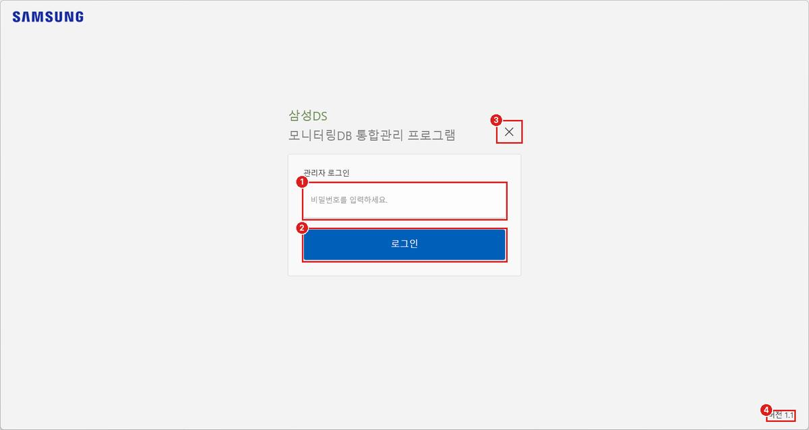

| 번호 | 설명 |
|---|---|
| ① | 비밀번호 칸 |
| ② | [로그인] |
| ③ | [프로그램 닫기] |
| ④ | 판(버전) |

| 기능 | 설명 |
|---|---|
| 「관리자 로그인」 비밀번호 칸 | 관리자 비밀번호를 넣고 [로그인] 또는 **Enter** |
| [로그인] | 맞으면 주 화면으로 돌아감 · 틀리면 「비밀번호가 잘못되었습니다.」 |
| [프로그램 닫기] | 오른쪽 위 × — 프로그램을 끝냄 |
| 「버전」 | 오른쪽 아래 — 프로그램 판(앞 두 자리) |

- 비밀번호는 DB 에 저장된 관리자 비밀번호입니다. 바꾸는 법은 1.3 에 있습니다.

## 1.2. 주 메뉴

주 화면은 왼쪽 **주 메뉴**와 오른쪽 **페이지 영역**으로 나뉩니다. 주 메뉴에서 고른 화면이 페이지 영역에 열립니다.

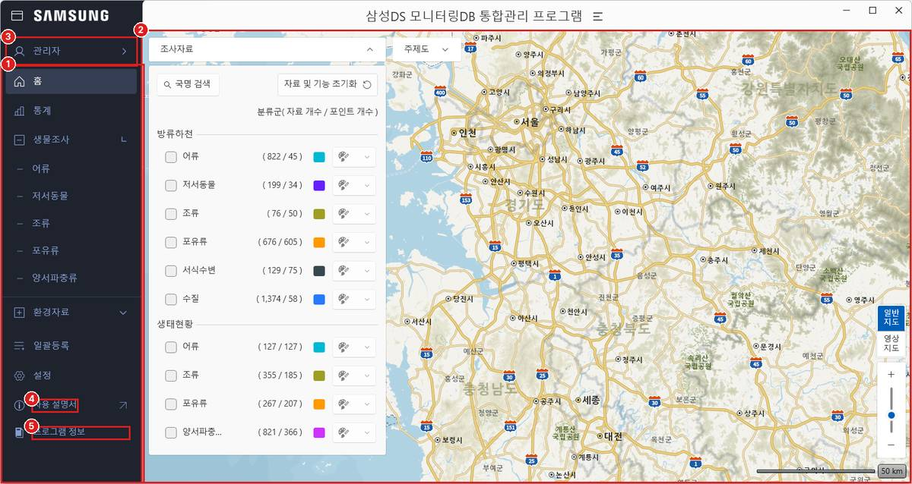

| 번호 | 설명 |
|---|---|
| ① | 주 메뉴 |
| ② | 페이지 영역 |
| ③ | [관리자] |
| ④ | [사용 설명서] |
| ⑤ | [프로그램 정보] |

| 주 메뉴 | 설명 |
|---|---|
| [관리자] | 로그아웃 · 화면잠금 · 비밀번호 변경(→ 1.3) |
| 홈 | 지도 위 조사 지점 · 주제도(→ 2장) |
| 통계 | 방류하천 자료 통계(→ 7장) |
| 생물조사 | 어류 · 저서동물 · 조류 · 포유류 · 양서파충류(→ 3장) — 눌러 펼침 |
| 환경자료 | 서식수변 · 수질(→ 4장) — 눌러 펼침 |
| 일괄등록 | 엑셀 자료를 한꺼번에 등록(→ 5장) |
| 설정 | 프로젝트 사업장 지점 · 조사지점 관리 · 조사자 기준자료(→ 6장) |
| [사용 설명서] | 이 설명서를 엶(→ 8.1) |
| [프로그램 정보] | 판 · 적용 지침 · 연락처(→ 8.2) |

- 식물상 · 식생 화면은 이 판에서 쓰지 않습니다.

| 번호 | 설명 |
|---|---|
| ① | 주 메뉴 보이기 · 숨기기 |
| ② | 프로그램 이름 |
| ③ | [전체 메뉴] |
| ④ | 창 단추(최소화 · 최대화 · 닫기) |

| 기능 | 설명 |
|---|---|
| 주 메뉴 보이기 · 숨기기 | 주 메뉴를 접어 페이지 영역을 넓힘 · 다음 실행에도 그대로 · 접으면 그 자리의 단추가 주 메뉴를 페이지 위에 잠깐 펼침(화면을 고르면 다시 접힘) |
| 프로그램 이름 | 끌어서 창을 옮김 · 두 번 누르면 최대화 |
| [전체 메뉴] | 모든 화면을 한 판에 보여 줌(→ {{그림 1-4_full-menu}}) |
| 창 단추 | 「최소화」 · 「최대화」 · 「닫기」 — 창 크기 · 위치는 다음 실행에도 그대로 |

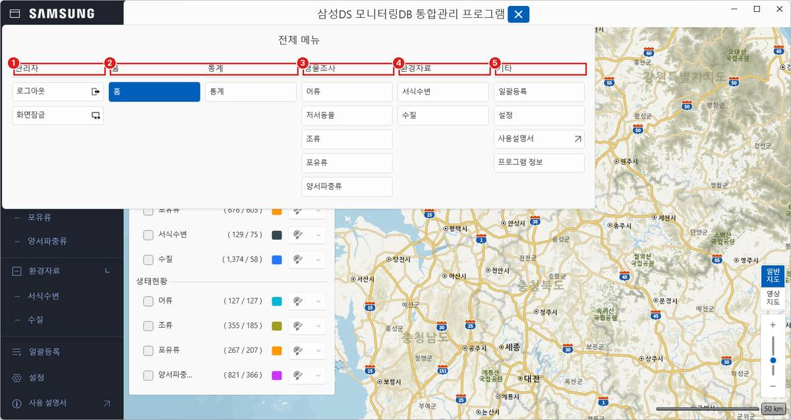

| 번호 | 설명 |
|---|---|
| ① | 관리자 |
| ② | 홈 · 통계 |
| ③ | 생물조사 |
| ④ | 환경자료 |
| ⑤ | 기타 |

- 「기타」 에는 일괄등록 · 설정 · [사용설명서] · [프로그램 정보] 가 있습니다.

## 1.3. 관리자

주 메뉴 [관리자] 를 누르면 로그아웃 · 화면잠금 · 비밀번호 변경이 펼쳐집니다.

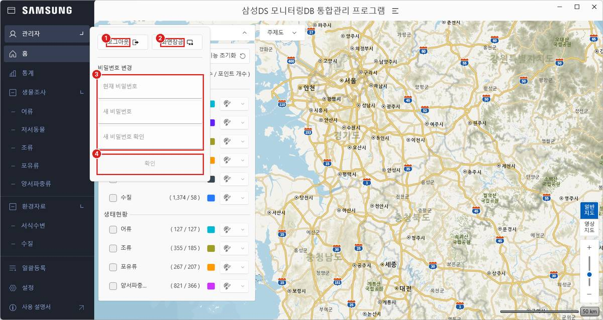

| 번호 | 설명 |
|---|---|
| ① | [로그아웃] |
| ② | [화면잠금] |
| ③ | 비밀번호 변경 칸(현재 · 새 · 새 확인) |
| ④ | [확인] |

| 기능 | 설명 |
|---|---|
| [로그아웃] | 로그인 화면으로(→ 1.1) · 비밀번호를 넣어야 다시 씀 |
| [화면잠금] | 화면을 가림(→ {{그림 1-6_screen-lock}}) · 자리를 비울 때 · 로그인과 같은 관리자 비밀번호로 풂 |
| 「비밀번호 변경」 | 현재 비밀번호 · 새 비밀번호 · 새 비밀번호 확인을 넣고 [확인] — 세 칸을 다 채워야 [확인] 이 켜짐 |
| 틀렸을 때 | 「현재 비밀번호가 잘못되었습니다.」 · 「새 비밀번호가 잘못되었습니다.」(새 비밀번호 두 칸이 다름) |
| 바뀌었을 때 | 알림 「자료가 저장되었습니다.」 |

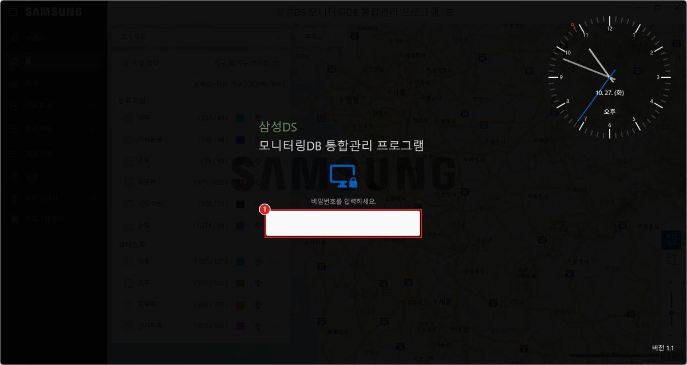

| 번호 | 설명 |
|---|---|
| ① | 비밀번호 칸 |

- 잠긴 화면에 「비밀번호를 입력하세요.」 가 뜹니다. 관리자 비밀번호를 치면 다 치는 순간 풀립니다(**Enter** 를 누르지 않아도 됨).
- 잠글 때마다 DB 에 저장된 관리자 비밀번호를 읽습니다. 「비밀번호 변경」 으로 바꾸면 바로 그 비밀번호로 풀리고, 프로그램을 다시 시작해도 같습니다.
- DB 에 관리자 계정이 없으면 「관리자 계정을 찾을 수 없어 화면을 잠그지 않았습니다.」 가 뜨고 잠그지 않습니다.

## 1.4. 목록 화면 공통

생물조사 · 환경자료 화면(3장 · 4장)은 모두 같은 꼴의 목록 화면입니다. 위쪽 단추 줄 · 검색 줄 · 목록 표 · 아래 페이지 줄로 이뤄집니다.

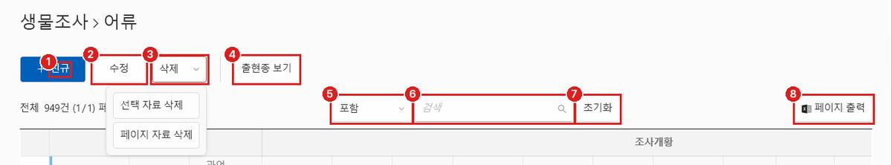

| 번호 | 설명 |
|---|---|
| ① | [신규] |
| ② | [수정] |
| ③ | [삭제] — [선택 자료 삭제] · [페이지 자료 삭제] |
| ④ | [출현종 보기] |
| ⑤ | 검색 방식(포함 · 일치 · 시작문자 · 끝문자) |
| ⑥ | 검색 칸 |
| ⑦ | [초기화] |
| ⑧ | [페이지 출력] |

| 기능 | 설명 |
|---|---|
| [신규] | 빈 편집기를 엶(→ 1.5) |
| [수정] | 목록에서 고른 행을 편집기로 엶 · 행을 두 번 눌러도 됨 |
| [삭제] | [선택 자료 삭제] = 고른 행 · [페이지 자료 삭제] = 지금 쪽에 보이는 행 모두 — 삭제 확인을 거침({{그림 1-9_delete-confirm}}) |
| [출현종 보기] | 어류 · 저서동물만 — 고른 조사의 출현종을 종마다 한 줄로(→ 3.1 · 3.2) |
| 전체 n건 | 목록 전체 건수 · (지금 쪽 / 전체 쪽) · 지금 쪽 행 수 |
| 검색 방식 · 검색 칸 | 포함 · 일치 · 시작문자 · 끝문자 중 하나를 고르고 글자를 넣어 **Enter** 또는 돋보기 — 모든 칸에서 찾음 |
| [초기화] | 검색 · 필터를 지우고 전체 목록으로 |
| [페이지 출력] | 지금 목록을 엑셀(.xlsx)로 저장 · 다 되면 알림 「저장되었습니다.」 |

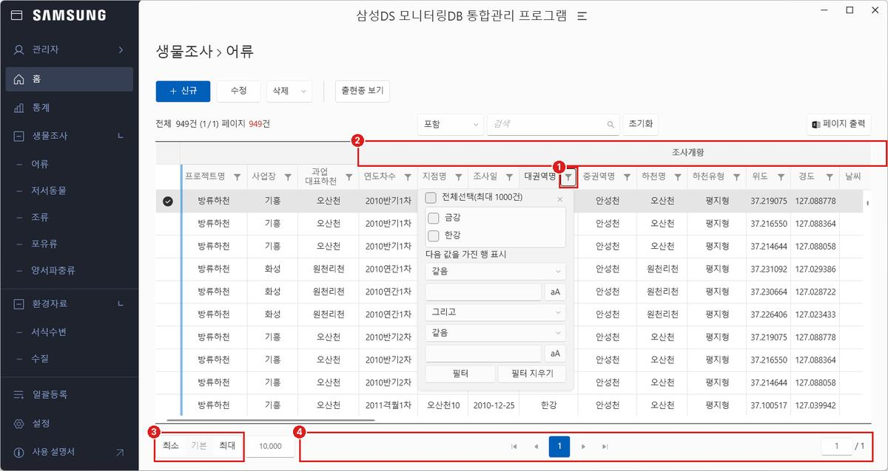

| 번호 | 설명 |
|---|---|
| ① | 열 필터 |
| ② | 열 묶음 머리글 |
| ③ | 페이지 크기 [최소] · [기본] · [최대] |
| ④ | 쪽 이동 · 쪽 번호 |

| 기능 | 설명 |
|---|---|
| 열 필터 | 머리글의 깔때기 — 값 고르기(전체선택은 최대 1000건) · 조건 두 개(같음 · 그리고 …) · [필터] · [필터 지우기] |
| 열 묶음 머리글 | 칸을 조사개황 · 채집방법 같은 묶음으로 보여 줌 |
| 정렬 | 머리글을 누르면 오름 · 내림 차순 |
| 페이지 크기 | 한 쪽에 보일 행 수 — [최소] 10 · [기본] 10,000 · [최대] 1,000,000 · 칸에 직접 넣어도 됨 |
| 쪽 이동 · 쪽 번호 | 처음 · 앞 · 뒤 · 끝 쪽 · 쪽 번호를 넣고 **Enter** |

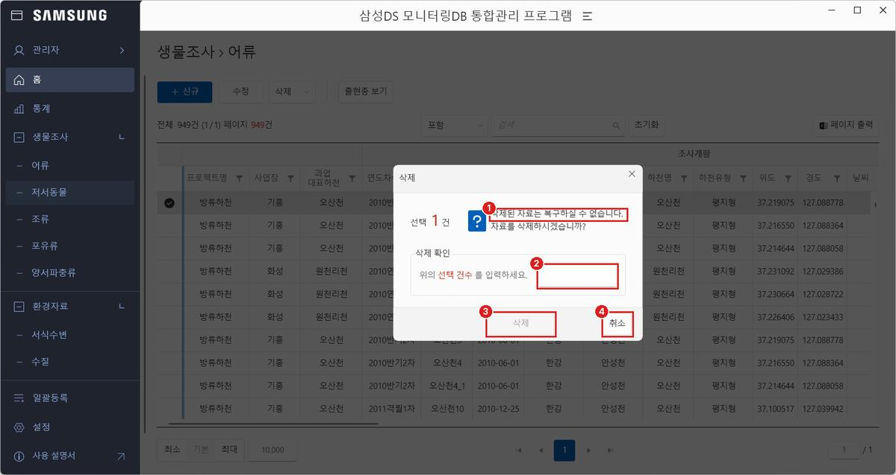

| 번호 | 설명 |
|---|---|
| ① | 안내 「삭제된 자료는 복구하실 수 없습니다.」 |
| ② | 선택 건수 입력 칸 |
| ③ | [삭제] |
| ④ | [취소] |

- '위의 선택 건수를 입력하세요.' — 위에 보인 건수와 같은 수를 넣어야 [삭제] 가 켜집니다.
- 지운 자료는 되살릴 수 없습니다. 지우기 전에 [페이지 출력] 으로 받아 둡니다.

## 1.5. 편집기(작성폼) 공통

[신규] · [수정] 을 누르면 목록 위에 편집기가 열립니다. 칸은 분류군마다 다르고(3장 · 4장) 쓰는 법은 같습니다.

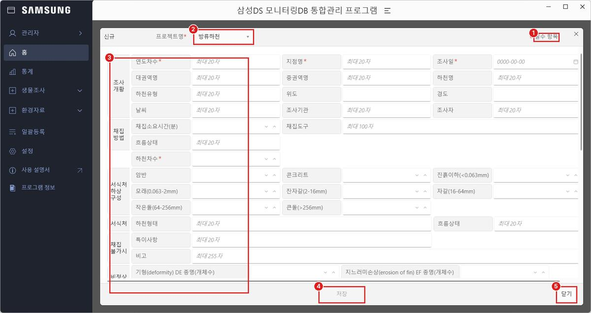

| 번호 | 설명 |
|---|---|
| ① | 필수 항목 표시(*) |
| ② | 프로젝트명(방류하천 · 생태현황) |
| ③ | 구역 이름(조사 개황 · 채집 방법 · 서식처 …) |
| ④ | [저장] |
| ⑤ | [닫기] |

| 기능 | 설명 |
|---|---|
| 「필수 항목」 | 이름 옆 * 칸을 다 채워야 [저장] 이 켜짐 |
| 프로젝트명 | 방류하천 · 생태현황 — 방류하천이면 「지점명」 이 필수 |
| 구역 이름 | 왼쪽 세로 글 — 칸 묶음(조사 개황 · 채집 방법 …) · 한 화면에 이어져 있어 아래로 내려 가며 씀 |
| 글자 칸 | 흐린 글 「최대 20자」 처럼 넣을 수 있는 길이를 보임 |
| 숫자 칸 | 숫자만 · 위 · 아래 화살표로 늘리고 줄임 |
| 「조사일」 | 달력에서 고르거나 2026-10-28 꼴로 넣음 |
| [저장] | 저장하고 목록을 새로 읽음 · 알림 「자료가 저장되었습니다.」(수정이면 「자료가 수정되었습니다.」) |
| [닫기] · × | 저장하지 않고 닫음 |

# 2. 홈

지도 위에 조사 지점과 주제도를 보여 줍니다. 지도 · 주제도 파일은 설치 폴더 `mbtiles\` 에 있어야 보입니다(→ 9.1).

## 2.1. 조사자료 · 주제도

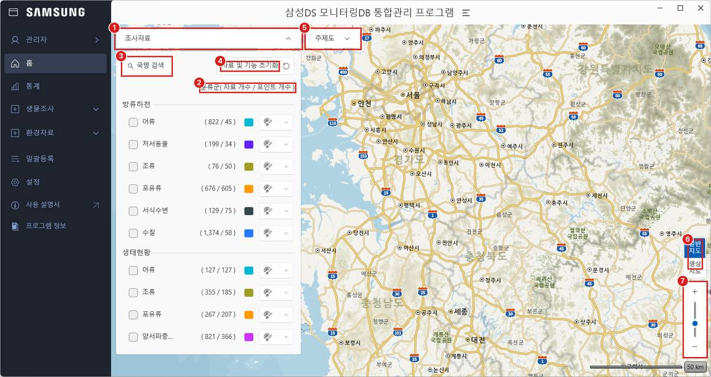

| 번호 | 설명 |
|---|---|
| ① | 조사자료 |
| ② | 분류군(자료 개수 / 포인트 개수) |
| ③ | [국명 검색] |
| ④ | [자료 및 기능 초기화] |
| ⑤ | 주제도 |
| ⑥ | 일반 지도 · 영상 지도 |
| ⑦ | 확대 · 축소 |

| 기능 | 설명 |
|---|---|
| 「조사자료」 | 눌러 펼치거나 접음 |
| 분류군 | 방류하천 · 생태현황마다 분류군을 체크하면 지도에 지점이 나옴 · 괄호는 (자료 개수 / 포인트 개수) — 포인트는 좌표가 같은 자료를 한 점으로 셈 |
| 색 단추 | 분류군마다 지점 색을 바꿈({{그림 2-5_color}}) · 다음 실행에도 그대로 |
| [국명 검색] | 종 이름으로 찾기({{그림 2-3_species-search}}) |
| [자료 및 기능 초기화] | 체크 · 검색 · 지도 상태를 처음으로 |
| 「주제도」 | 비오톱 희소성 · 생태계교란종(→ {{그림 2-7_theme-map}}) |
| 일반 · 영상 지도 | 바탕 지도를 바꿈 |
| 확대 · 축소 | 「확대」 · 「축소」 단추 · 마우스 휠 · 끌어서 이동 |

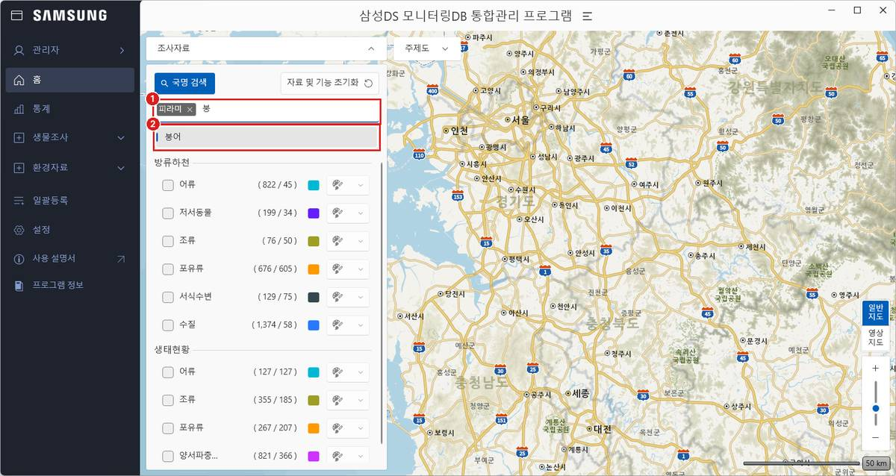

| 번호 | 설명 |
|---|---|
| ① | 국명 칸(여러 개) |
| ② | 제시 목록 |

- 글자를 치면 맞는 국명이 제시 목록에 나옵니다. 여러 종을 고를 수 있고, 고른 종이 나온 지점만 지도에 남습니다.

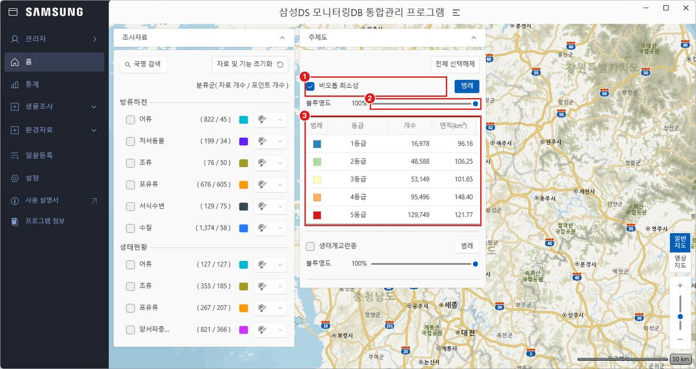

| 번호 | 설명 |
|---|---|
| ① | 주제도 고르기 |
| ② | 불투명도 |
| ③ | 범례 |

| 기능 | 설명 |
|---|---|
| 주제도 체크 | 비오톱 희소성 · 생태계교란종을 지도에 겹침 |
| [범례] | 등급 · 개수 · 면적(km²) — 생태계교란종은 교란종 · 개체수 |
| 「불투명도」 | 막대를 끌어 겹친 주제도를 옅게 · 진하게 |
| [전체 선택해제] | 주제도 체크를 모두 끔 |

## 2.2. 지도 좌표

지도의 지점을 누르면 그 자리의 조사 자료가 나옵니다.

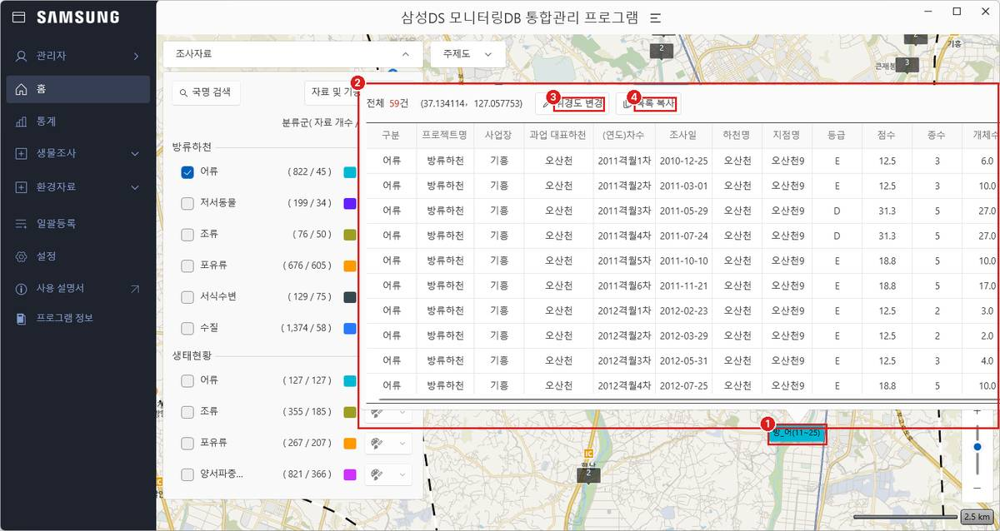

| 번호 | 설명 |
|---|---|
| ① | 지점(누르면 정보 창) |
| ② | 지점 정보 — 그 지점의 자료 목록 |
| ③ | [위경도 변경] |
| ④ | [목록 복사] |

| 기능 | 설명 |
|---|---|
| 지점 · 묶음 | 가까운 지점은 숫자 묶음으로 보임 · 묶음을 누르면 그 자리로 확대 |
| 지점 정보 | 분류군 · 프로젝트 · 사업장 · 연도차수 · 조사일 · 지점명 · 등급 · 점수 · 종수 · 출현종 등 |
| [목록 복사] | 지점 정보 목록을 클립보드로(엑셀에 붙여 넣기) |
| [위경도 변경] | 이 지점 자료의 좌표를 한꺼번에 고침(→ 2.3) |
| 지도에서 오른쪽 단추 | 그 자리의 좌표를 [복사] |

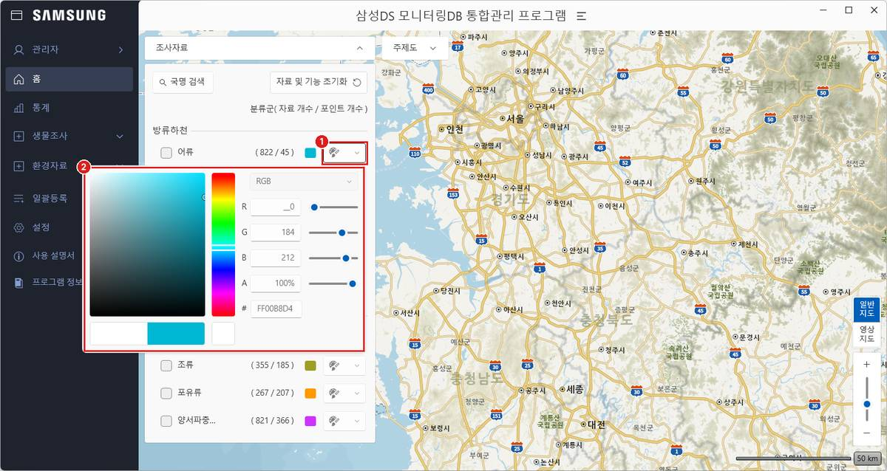

| 번호 | 설명 |
|---|---|
| ① | 색 단추 |
| ② | 색 고르기 |

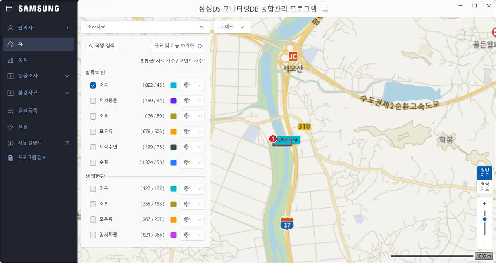

| 번호 | 설명 |
|---|---|
| ① | 지점 이름표 「방_어(24)」 |

- 이름표는 '프로젝트 첫 글자_분류군 첫 글자(조사 연도 끝 두 자리)' 입니다. 「방_어(11~24)」 는 방류하천 어류 · 2011~2024년 자료입니다.

## 2.3. 위경도 변경

[위경도 변경] 을 누르면 그 지점 자료의 위도 · 경도를 한꺼번에 바꿉니다.

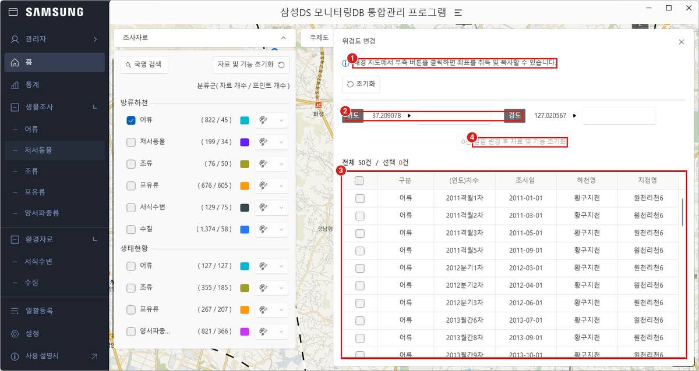

| 번호 | 설명 |
|---|---|
| ① | 안내 — 지도에서 오른쪽 단추로 좌표 얻기 |
| ② | 위도 · 경도 |
| ③ | 바꿀 자료 고르기 |
| ④ | [일괄 변경 후 자료 및 기능 초기화] |

1. 지도에서 바른 자리를 오른쪽 단추로 눌러 좌표를 얻습니다(「배경 지도에서 우측 버튼을 클릭하면 좌표를 취득 및 복사할 수 있습니다.」).
2. 위도 · 경도를 넣습니다. [초기화] 는 두 칸을 비웁니다.
3. 목록에서 바꿀 자료를 고릅니다(전체 n건 / 선택 n건).
4. [일괄 변경 후 자료 및 기능 초기화] 를 누릅니다. 고른 자료의 좌표가 DB 에서 바뀌고 홈이 처음 상태로 돌아갑니다.

> ⚠ 좌표는 DB 의 조사 자료를 바로 고칩니다. 지점 마스터(sites.json)의 좌표는 바뀌지 않습니다(→ 6.2).

# 3. 생물조사

주 메뉴 「생물조사」 에서 [어류] · [저서동물] · [조류] · [포유류] · [양서파충류] 를 누르면 그 분류군의 목록 화면이 열립니다. 화면마다 목록과 편집기로 이루어집니다.

| 화면 | 기록 1건 | 출현종 | [저장] 할 때 계산 |
|---|---|---|---|
| 어류 | 지점 · 연도차수의 조사 1회 | 기록 안에 여러 종 · [출현종 보기] | FAI |
| 저서동물 | 지점 · 연도차수의 조사 1회 | 기록 안에 여러 종 · [출현종 보기] | DI · H′ · R1 · J′ · BMI |
| 조류 · 포유류 · 양서파충류 | 출현종 1종의 관찰 1건 | 기록 안에 일반명 1종 | 없음 |

- 목록 단추 · 검색 · 필터 · 삭제 · 페이지 크기는 모든 화면이 같습니다(→ 1.4).
- 편집기 공통 규칙(필수 항목 「*」 · 「프로젝트명」 · 지점명 확인 · [저장] · [닫기])은 1.5 를 봅니다.
- 여러 기록을 한꺼번에 넣을 때는 일괄등록을 씁니다(→ 5장).

## 3.1. 어류

어류 조사 기록을 지점 · 회차마다 1건씩 관리합니다. 기록에는 조사개황 · 채집방법 · 서식처 · 비정상종과 출현종 개체수가 들어 있습니다. [저장] 할 때 출현종 개체수와 종목록 길드로 FAI(어류평가지수)를 계산해 함께 저장합니다.

### 목록

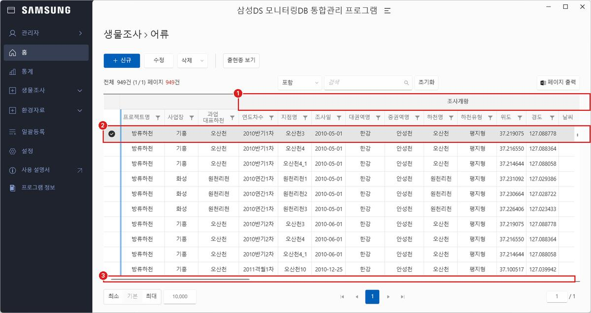

| 번호 | 설명 |
|---|---|
| ① | 열 묶음 머리글(조사개황 …) |
| ② | 고른 행 — [수정] · [출현종 보기] 의 대상 |
| ③ | 가로 스크롤 — 오른쪽 묶음(채집방법 · 서식처 · 군집정보 · 건강성 · 출현종) |

| 열 묶음 | 열 |
|---|---|
| (묶음 없음) | 프로젝트명 · 사업장 · 과업 대표하천 · 하천차수 |
| 「조사개황」 | 연도차수 · 지점명 · 조사일 · 대권역명 · 중권역명 · 하천명 · 하천유형 · 위도 · 경도 · 날씨 · 조사기관 · 조사자 |
| 「채집방법」 | 「채집 소요시간(분)」 · 채집도구 · 흐름상태 |
| 「서식처 하상구조」 | 암반 · 콘크리트 · 진흙이하 · 모래 · 잔자갈 · 자갈 · 작은돌 · 큰돌 — 8칸 |
| 「서식처」 | 하천형태 · 흐름상태 |
| 「채집 불가시」 | 특이사항(조사불가 사유) · 비고 |
| 「비정상종」 | DE(기형) · EF(지느러미손상) · LE(피부손상) · TU(종양) 개체수 |
| 「군집정보」 | 총 개체수 · 총 종수 · M1 ~ M7 산출값 |
| 「건강성」 | 「FAI 점수」 · 「FAI 등급」 |
| 「출현종」 | 종수 · 개체수 — 그 기록에 저장된 출현종 행 수 · 개체수 합 |

| 기능 | 설명 |
|---|---|
| [신규] | 자료 추가 — 빈 편집기(제목 「신규」)를 엶 |
| [수정] | 선택된 자료 수정 — 고른 행을 편집기(제목 「수정」)로 엶 |
| [삭제] | [선택 자료 삭제] · [페이지 자료 삭제](→ 1.4) |
| [출현종 보기] | 조사자료와 출현종 상세보기 |
| [페이지 출력] | 목록 페이지 엑셀 출력 |

- 위도 · 경도는 소수 6자리로 보입니다.
- 「군집정보」 · 「건강성」 은 직접 넣는 칸이 아닙니다. 편집기 · 일괄등록이 [저장] 할 때 다시 계산해 넣습니다(아래 FAI).

### 출현종 보기

[출현종 보기] 를 누르면 목록 위에 출현종 창이 열립니다. 출현종 한 종이 한 줄이고, 앞쪽에 그 종이 나온 기록의 칸이 함께 보입니다({{그림 3-2_fish-species}}).

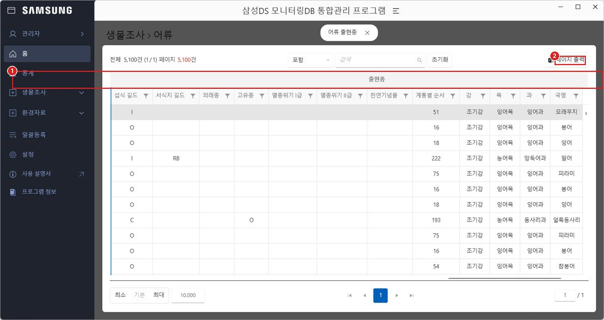

| 번호 | 설명 |
|---|---|
| ① | 출현종 — 종마다 한 줄 |
| ② | [페이지 출력] |

| 기능 | 설명 |
|---|---|
| 「ID」 | 기록 번호 — 같은 기록의 종은 ID 가 같음 |
| 기록 칸 | 「조사개황」 ~ 「비정상종」 · FAI 점수 · FAI 등급(목록과 같은 열) |
| 「출현종」 묶음 | 「어류특성확정」 · 「내성도 길드」 · 「섭식 길드」 · 「서식지 길드」 · 「외래종」 · 「고유종」 · 「멸종위기 I급」 · 「멸종위기 II급」 · 「천연기념물」 · 「계통별 순서」 · 강 · 목 · 과 · 국명 · 학명 · 개체수 |
| 검색 · 페이지 크기 | 목록과 같음(→ 1.4) |
| [페이지 출력] | 출현종 페이지 엑셀 출력 |
| [어류 출현종] | 출현종 창 닫기 |

- 고른 행의 종만이 아니라 모든 기록의 출현종이 나옵니다. 지점명 · 연도차수 · 국명으로 검색해 좁힙니다.

### 편집기

[신규] 또는 [수정] 을 누르면 편집기가 열립니다. 칸은 왼쪽 묶음 이름 순서로 한 화면에 이어집니다 — 조사개황 · 채집방법 · 서식처 하상구성 · 서식처 · 채집 불가시 · 비정상종 · 생물종.

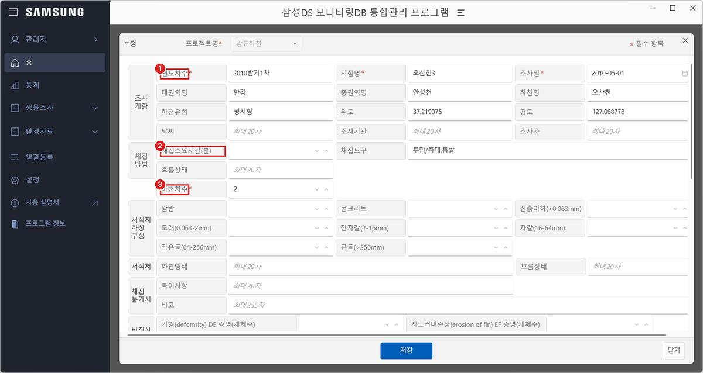

| 번호 | 설명 |
|---|---|
| ① | 조사개황 |
| ② | 채집방법 |
| ③ | 하천차수(*) |

| 묶음 | 칸 · 입력 |
|---|---|
| 조사개황 | 「연도차수」 · 「지점명」 · 「조사일」 · 「대권역명」 · 「중권역명」 · 「하천명」 · 「하천유형」 · 「위도」 · 「경도」 · 「날씨」 · 「조사기관」 · 「조사자」 |
| 채집방법 | 「채집소요시간(분)」(1 이상 정수) · 「채집도구」 · 「흐름상태」(글) |
| 채집방법 아래 | 「하천차수」(1 이상 정수 · 저장 조건은 아래 · {{그림 3-3_fish-editor}} ③) |
| 서식처 하상구성 | 「암반」 · 「콘크리트」 · 「진흙이하(<0.063mm)」 · 「모래(0.063-2mm)」 · 「잔자갈(2-16mm)」 · 「자갈(16-64mm)」 · 「작은돌(64-256mm)」 · 「큰돌(>256mm)」 — 0 이상 정수 |
| 서식처 | 「하천형태」 · 「흐름상태」(글) |
| 채집 불가시 | 「특이사항」(조사불가 사유) · 「비고」 |
| 비정상종 | 「기형(deformity) DE 종명(개체수)」 등 4칸 — 개체수(정수) |
| 생물종 | 종목록 표 · 「개체수(작성)」 |

- 채집방법의 「흐름상태」 와 서식처의 「흐름상태」 는 다른 칸입니다.
- 「특이사항」(채집 불가시)은 조사불가 사유 칸입니다. FAI 등급 '-' 판정에 쓰입니다(아래 FAI). 그 밖의 메모는 「비고」 에 적습니다.

### 하천차수와 [저장]

[저장] 은 공통 필수 칸(→ 1.5)에 더해 「하천차수」 가 있어야 켜집니다. 다음 경우에는 하천차수 없이도 저장됩니다.

| 경우 | 하천차수 |
|---|---|
| 「특이사항」(채집 불가시)이 조사불가 네 낱말(접근불가 · 건천화 · 준설 · 공사중) 중 하나 — 띄어쓰기 무시 | 없어도 저장 |
| 생물종 개체수를 하나도 넣지 않음(0종) | 없어도 저장 |
| 그 밖 | 필수 |

- 하천차수는 FAI M1 · M2 · M3 · M7 의 구간표를 고르는 값입니다(아래 FAI 점수 구간).
- 편집기는 하천차수를 지점 목록에서 채우지 않습니다. 직접 넣습니다.

> ⚠ 「특이사항」 에 네 낱말 밖의 글(예 `접근불가(홍수)` · `우천`)이 있으면 조사불가가 아닙니다. FAI 를 계산하므로, 종이 있으면 하천차수를 넣어야 [저장] 이 켜집니다.

### 비정상종 · 생물종

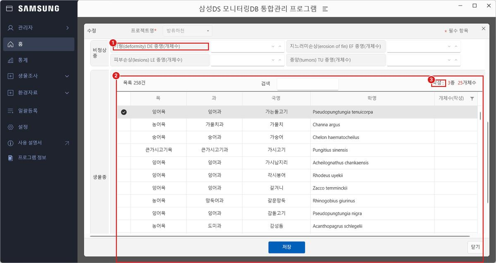

| 번호 | 설명 |
|---|---|
| ① | 비정상종 4칸 |
| ② | 생물종 — 종목록의 종마다 개체수 |
| ③ | 작성한 종 수 · 개체수 |

1. 「생물종」 표에서 종을 찾습니다. 표에는 어류 종목록의 종이 모두 들어 있습니다(목 · 과 · 국명 · 학명). 표 위 검색 칸으로 찾을 수도 있습니다.
2. 「개체수(작성)」 칸을 눌러 개체수(0 이상 정수)를 넣습니다.
3. 표 위쪽 「작성 : 」 줄에서 개체수를 넣은 종 수와 개체수 합을 확인합니다.
4. [저장] 을 누릅니다.

- 개체수가 1 이상인 종만 출현종으로 저장됩니다. 비우거나 0 인 종은 저장되지 않습니다.
- [수정] 에서 [저장] 하면 그 기록의 출현종 행을 모두 지우고 지금 표의 값으로 다시 씁니다.
- 비정상종 4칸의 합은 FAI M8 에 쓰입니다.

### 종 행의 지표값 · 목록 밖 종

- 종 행의 어류특성확정 · 내성도 길드 · 섭식 길드 · 서식지 길드 · 외래종 · 고유종 · 멸종위기 I급 · II급 · 천연기념물 · 계통별 순서 · 강 · 목 · 과는 **종목록 값**으로 저장됩니다. 옛 기록의 종 행 값이 종목록과 달라도 [수정] → [저장] 하면 종목록 값이 됩니다(→ 5.5 · 부록 C).
- 종목록과는 국명 · 학명을 글자 그대로(띄어쓰기 · 대소문자 포함) 맞대어 봅니다.
- 기록의 종 행 가운데 종목록에 없는 종(목록 밖 종)은 표 맨 끝에 붙습니다. 그 행 값 그대로 보이고, [저장] 하면 그대로 다시 저장됩니다(지워지지 않음).
- 일괄등록으로 들어온 목록 밖 종은 지표값 · 길드가 비어 있습니다(→ 5.4). 이런 행은 총 종수 · 총 개체수에는 들어가고, 길드로 세는 M2 ~ M6 에는 들어가지 않습니다. 외래종 칸이 비어 있으므로 M1 · M7 에는 국내종으로 셉니다.

### FAI(어류평가지수)

[저장] 할 때 FAI 를 계산해 「군집정보」 · 「건강성」 칸에 저장합니다. 계산 값은 편집기에 보이지 않고 목록에서 봅니다.

| 경우 | 「FAI 점수」 | 「FAI 등급」 | 「군집정보」 |
|---|---|---|---|
| 「특이사항」 이 접근불가 · 건천화 · 준설 · 공사중 중 하나(띄어쓰기 무시) | 빈칸 | `-` | 빈칸 |
| 개체수 1 이상인 종이 없음(0종) | 0 | E | 0 |
| 그 밖 | M1 ~ M8 합 | A ~ E | 산출값 |

- 띄어쓰기를 뺀 글이 네 낱말 중 하나와 같아야 조사불가로 봅니다. 예를 들어 `접근 불가` 는 조사불가이고, `접근불가(홍수)` 는 조사불가가 아니어서 FAI 를 계산합니다.

### FAI 산출값

개체수 1 이상인 종만 셉니다. 외래종은 「외래종」 칸이 `O` 인 종, 길드는 종 행의 「내성도 길드」 · 「섭식 길드」 · 「서식지 길드」 코드입니다.

| 항목 | 목록 열 | 세는 것 |
|---|---|---|
| 총 종수 · 총 개체수 | 「총 종수」 · 「총 개체수」 | 종 수 · 개체수 합 |
| M1 | 「국내종 총 종수」 | 총 종수 − 외래종 종수 |
| M2 | 「여울성 저서 종수」 | 서식지 길드 `RB` 종수 |
| M3 | 「민감 종수」 | 내성도 길드 `SS` 종수 |
| M4 | 「내성종 개체수 비율(%)」 | 내성도 길드 `TS` 개체수 ÷ 총 개체수 × 100 |
| M5 | 「잡식종 개체수 비율(%)」 | 섭식 길드 `O` 개체수 ÷ 총 개체수 × 100 |
| M6 | 「충식종 개체수 비율(%)」 | 섭식 길드 `I` 개체수(외래종 빼고) ÷ 총 개체수 × 100 |
| M7 | 「국내종 총 개체수」 | 총 개체수 − 외래종 개체수 |
| M8 | (목록 열 없음) | 비정상종 4칸 합 ÷ 총 개체수 × 100 |

- M4 ~ M6 은 소수 1자리로 반올림해 저장합니다.

### FAI 점수 구간

M1 ~ M8 은 항목마다 0 · 6.25 · 12.5점입니다.

| 항목 | 0점 | 6.25점 | 12.5점 |
|---|---|---|---|
| M4 · M5 | 70 초과 | 30 ~ 70 | 30 미만 |
| M6 | 20 미만 | 20 ~ 45 | 45 초과 |
| M8 | 1 초과 | 0 초과 ~ 1 | 0 |

M1 · M2 · M3 · M7 은 하천차수별 구간입니다. 칸 안은 0점 · 6.25점 · 12.5점 구간입니다.

| 하천차수 | M1 국내종 총 종수 | M2 여울성 저서 종수 | M3 민감 종수 | M7 국내종 총 개체수 |
|---|---|---|---|---|
| 1 | ≤1 · 2 · ≥3 | 0 · 1 · ≥2 | 0 · 1~2 · ≥3 | ≤10 · 11~20 · ≥21 |
| 2 | ≤2 · 3~5 · ≥6 | 0 · 1~2 · ≥3 | 0 · 1~3 · ≥4 | ≤30 · 31~55 · ≥56 |
| 3 | ≤4 · 5~8 · ≥9 | 0 · 1~2 · ≥3 | ≤1 · 2~4 · ≥5 | ≤50 · 51~90 · ≥91 |
| 4 | ≤5 · 6~11 · ≥12 | ≤1 · 2~3 · ≥4 | ≤1 · 2~4 · ≥5 | ≤60 · 61~115 · ≥116 |
| 5 | ≤7 · 8~14 · ≥15 | 0 · 1~2 · ≥3 | ≤1 · 2~4 · ≥5 | ≤80 · 81~160 · ≥161 |
| 6 | ≤9 · 10~18 · ≥19 | 0 · 1~2 · ≥3 | 0 · 1~3 · ≥4 | ≤100 · 101~200 · ≥201 |
| 7 | ≤11 · 12~22 · ≥23 | 0 · 1 · ≥2 | 0 · 1~2 · ≥3 | ≤120 · 121~240 · ≥241 |

- 하천차수가 비었거나 1 ~ 7 밖이면 M1 · M2 · M3 · M7 은 0점입니다.
- 「FAI 점수」 = M1 ~ M8 합(최대 100) · 소수 1자리 반올림입니다.
- 「FAI 등급」: A ≥80 · B ≥60 · C ≥40 · D ≥20 · 그 밖 E.

## 3.2. 저서동물

저서동물 조사 기록을 지점 · 회차마다 1건씩 관리합니다. [저장] 할 때 출현종 개체수와 종목록의 오탁치 · 지표가중치로 군집지수(DI · H′ · R1 · J′)와 BMI(저서동물지수)를 계산해 함께 저장합니다.

### 목록

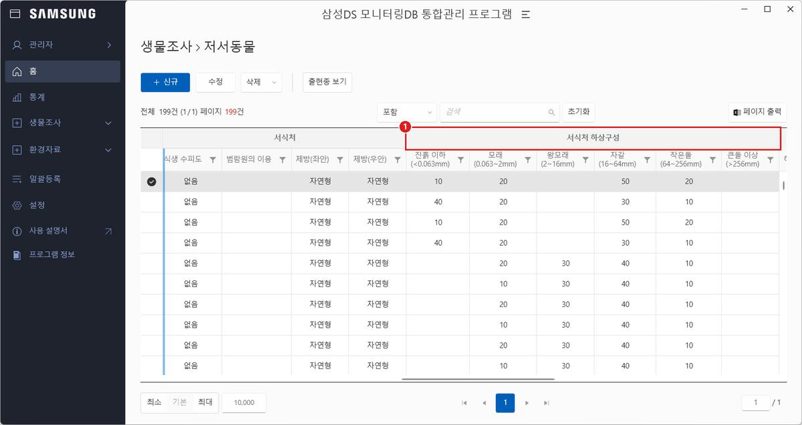

| 번호 | 설명 |
|---|---|
| ① | 서식처 하상구성 6칸 |

| 열 묶음 | 열 |
|---|---|
| (묶음 없음) | 프로젝트명 · 사업장 · 과업 대표하천 |
| 「조사개황」 | 어류와 같은 12열(→ 3.1) |
| 「채집방법」 | 「Surber net(30*30)」 · 「Surber net(50*50)」 · 드렛지 · 에크만 |
| 「서식처」 | 유역이용 · 「확인 가능 오염원」 · 식생 수피도 · 범람원의 이용 · 제방(좌안) · 제방(우안) |
| 「서식처 하상구성」 | 「진흙 이하(<0.063mm)」 · 「모래(0.063~2mm)」 · 「왕모래(2~16mm)」 · 「자갈(16~64mm)」 · 「작은돌(64~256mm)」 · 「큰돌 이상(>256mm)」 — 6칸 |
| 「서식처」 | 하천유형 · 하폭 · 수폭 · 평균수심 · 평균유속 · 기온 · 수온 · 흐름상태 · 투명도 · 냄새 · 특이사항 |
| 「기타」 | 채집불가시(조사불가 사유) |
| 「군집지수」 | 「우점도(DI)」 · 「다양도(H')」 · 「종풍부도(R1)」 · 「균등도(J')」 |
| 「건강성」 | 「BMI 점수」 · 「BMI 등급」 |
| 「출현종」 | 종수 · 개체수 — 그 기록에 저장된 출현종 행 수 · 개체수 합 |

| 기능 | 설명 |
|---|---|
| [신규] | 자료 추가 — 빈 편집기를 엶 |
| [수정] | 선택된 자료 수정 — 고른 행을 편집기로 엶 |
| [삭제] | [선택 자료 삭제] · [페이지 자료 삭제](→ 1.4) |
| [출현종 보기] | 조사자료와 출현종 상세보기 |
| [페이지 출력] | 목록 페이지 엑셀 출력 |

- 화면 자릿수: 군집지수 4열은 소수 2자리, 「BMI 점수」 · 하폭 ~ 수온 · 개체수는 소수 1자리입니다. 군집지수 · 하폭 ~ 수온 · 개체수는 원값으로 저장되고 자릿수는 화면에만 적용됩니다. BMI 점수는 소수 1자리로 계산해 저장합니다.
- 하상은 지침 서식 2 의 6칸입니다. 암반 · 콘크리트 열은 목록에 없습니다(아래 하상 6칸 · {{그림 3-7_benthos-substrate}}).

### 출현종 보기

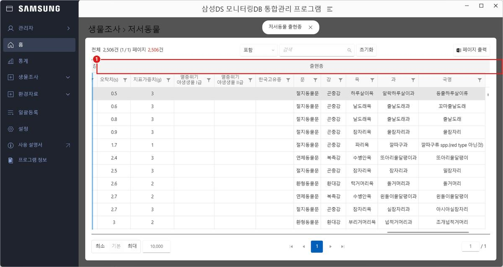

| 번호 | 설명 |
|---|---|
| ① | 출현종 — 오탁치 · 지표가중치 · 개체수 |

| 기능 | 설명 |
|---|---|
| 「ID」 | 기록 번호 — 같은 기록의 종은 ID 가 같음 |
| 기록 칸 | 「조사개황」 ~ 「기타」 · 군집지수 · BMI(목록과 같은 열) |
| 「출현종」 묶음 | 「오탁치(s)」 · 「지표가중치(g)」 · 멸종위기 야생생물 I급 · II급 · 「한국고유종」 · 문 · 강 · 목 · 과 · 국명 · 학명 · 개체수(소수 1자리) |
| 검색 · 페이지 크기 · [페이지 출력] | 어류 출현종 보기와 같음 |
| [저서동물 출현종] | 출현종 창 닫기 |

- 어류와 같이 모든 기록의 출현종이 나옵니다.

### 편집기

칸은 왼쪽 묶음 순서로 이어집니다 — 조사개황 · 채집방법 · 서식처 · 서식처 하상구성 · 서식처 · 채집 불가시 · 생물종.

| 묶음 | 칸 · 입력 |
|---|---|
| 조사개황 | 어류와 같은 12칸(→ 3.1) |
| 채집방법 | 「Surber net(30*30)」 · 「Surber net(50*50)」 · 「드렛지」 · 「에크만」 — 1 이상 정수 |
| 서식처 | 「유역이용」 · 「확인 가능 오염원」 · 「식생 수피도」 · 「범람원의 이용」 · 「제방(좌안)」 · 「제방(우안)」 — 글 |
| 서식처 하상구성 | 6칸 — 0 이상 정수(아래 하상 6칸) |
| 서식처 | 「하천유형」(글) · 「하폭, 제방과 제방사이 거리(m)」 · 「수폭, 물이 흐르는 하도의 거리(m)」 · 「평균수심, 샘플링 지점 평균(cm)」 · 「평균유속, 샘플링 지점 평균(cm/s)」(0 이상 소수) · 「기온」(-30 이상) · 「수온」(0 이상) · 「흐름상태」(글) · 「투명도」 · 「냄새」(1 ~ 5 정수) · 「특이사항」 |
| 채집 불가시 | 「채집불가시」(조사불가 사유) |
| 생물종 | 종목록 표 · 「개체수(작성)」 |

- 서식처의 「하천유형」 은 조사개황의 「하천유형」 과 다른 칸입니다.
- [저장] 은 공통 필수 칸(→ 1.5)만 있으면 켜집니다. 하천차수 칸은 없습니다.
- 하폭 ~ 수온은 칸에서 나가도 반올림하지 않습니다. 넣은 값 그대로 저장됩니다.

### 하상 6칸 · 암반 · 콘크리트

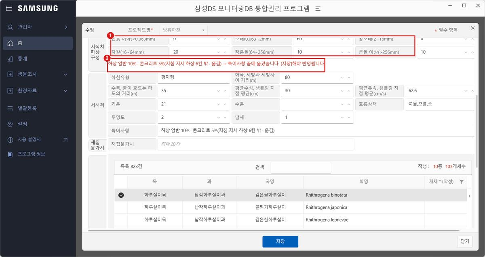

| 번호 | 설명 |
|---|---|
| ① | 하상 6칸(지침 서식 2) |
| ② | 안내 — 암반 · 콘크리트 값을 특이사항으로 옮김 |

- 저서 하상은 지침 서식 2 의 6칸입니다 — 진흙 이하 · 모래 · 왕모래 · 자갈 · 작은돌 · 큰돌 이상. 암반 · 콘크리트 칸은 없습니다.
- 하상 칸 아래 안내 줄은 평소 이렇게 보입니다.

> 「지침 저서 하상 6칸 — 암반·콘크리트는 칸 밖이라 값이 있으면 특이사항으로 옮깁니다」

- 암반 · 콘크리트 값(0보다 큼)이 있는 옛 기록을 [수정] 으로 열면, 그 값이 「특이사항」 끝에 「하상 암반 {n}% · 콘크리트 {n}%(지침 저서 하상 6칸 밖 · 옮김)」 꼴로 붙고(특이사항에 글이 있으면 ` / ` 로 이어 붙임) 안내 줄이 강조 색으로 바뀝니다.

> 「하상 암반 10% · 콘크리트 5%(지침 저서 하상 6칸 밖 · 옮김) → 특이사항 끝에 옮겼습니다. [저장]해야 반영됩니다」

1. 「특이사항」 에 옮겨진 글을 확인합니다.
2. [저장] 을 누릅니다. 특이사항이 저장되고 암반 · 콘크리트 칸은 비워집니다.

- 값이 0 이거나 빈칸이면 옮기지 않습니다.
- [닫기] 만 하면 기록은 바뀌지 않습니다. 다음에 열 때 다시 옮겨 보입니다.
- [신규] 로 만든 기록은 암반 · 콘크리트를 늘 비워 저장합니다.
- 일괄등록도 같은 글로 옮깁니다(→ 5.5).

### 생물종

입력 순서는 어류와 같습니다(→ 3.1 비정상종 · 생물종). 다른 점만 적습니다.

- 표에는 저서동물 종목록의 종이 모두 들어 있습니다(목 · 과 · 국명 · 학명).
- 「개체수(작성)」 는 0 이상 소수를 받습니다. 화면은 소수 1자리로 보입니다. 기록에 든 개체수(예 일괄등록의 `3.75`)는 [저장] 해도 그대로입니다.
- 개체수가 0 보다 큰 종만 출현종으로 저장됩니다.
- 종 행의 오탁치 · 지표가중치 · 멸종위기 I급 · II급 · 한국고유종 · 문 · 강 · 목 · 과는 **종목록 값**으로 저장됩니다(→ 5.5 · 부록 C).
- 목록 밖 종 행은 표 맨 끝에 붙고 행 값 그대로 다시 저장됩니다(어류와 같음). 일괄등록으로 들어온 목록 밖 종은 오탁치 · 지표가중치가 비어 있습니다(→ 5.4).

### 군집지수 · BMI

[저장] 할 때 계산해 「군집지수」 · 「건강성」 칸에 저장합니다. 계산 값은 목록에서 봅니다.

| 경우 | DI · H′ · R1 · J′ | 「BMI 점수」 | 「BMI 등급」 |
|---|---|---|---|
| 「채집불가시」 가 접근불가 · 건천화 · 준설 · 공사중 중 하나(띄어쓰기 무시) | 빈칸 | 빈칸 | `-` |
| 개체수가 0 보다 큰 종이 없음(0종) | 빈칸 | 0 | E |
| 그 밖 | 계산값 | 계산값 | A ~ E |

| 지수 | 목록 열 | 계산(개체수가 0 보다 큰 종만) |
|---|---|---|
| 우점도 | 「우점도(DI)」 | (개체수 1위 + 2위) ÷ 총 개체수 |
| 다양도 | 「다양도(H')」 | −Σ pᵢ × log₂ pᵢ (pᵢ = 종 i 개체수 ÷ 총 개체수) |
| 풍부도 | 「종풍부도(R1)」 | (출현종 수 − 1) ÷ ln(총 개체수) |
| 균등도 | 「균등도(J')」 | H′ ÷ log₂(출현종 수) · 출현종이 1종 이하면 0 |
| BMI | 「BMI 점수」 | (4 − Σ(s × g × h) ÷ Σ(g × h)) × 25 · 소수 1자리 반올림 |

- s 는 「오탁치(s)」, g 는 「지표가중치(g)」 — 종 행 값입니다(목록 종은 종목록 값).
- h 는 개체수 순위점수입니다. 개체수가 많은 순으로 매긴 순위 ÷ 출현종 수가 0.2 이하면 5 · 0.4 이하 4 · 0.6 이하 3 · 0.8 이하 2 · 그 밖 1 입니다. 순위는 개체수의 정수 부분으로 매깁니다.
- 「BMI 등급」: A ≥80 · B ≥65 · C ≥50 · D ≥35 · E ≥0 · 0 미만이면 `Check`.
- 오탁치 · 지표가중치가 빈 종은 g 가 0 이라 BMI 에 들어가지 않습니다. DI · H′ · R1 · J′ 에는 개체수대로 들어갑니다.
- 지표가중치가 있는 종이 하나도 없으면(Σ(g × h) = 0) BMI 점수 · 등급은 빈칸입니다.

## 3.3. 조류

조류 관찰 기록을 관리합니다. 기록 1건이 출현종 1종입니다(일반명 · 개체수 · 도래유형 · 서식지 유형). 계산하는 칸은 없습니다.

### 목록

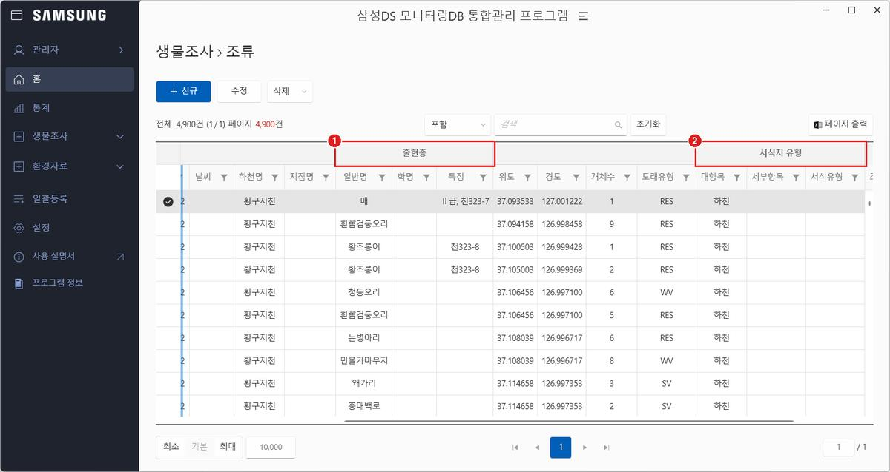

| 번호 | 설명 |
|---|---|
| ① | 출현종 |
| ② | 서식지 유형 |

| 열 묶음 | 열 |
|---|---|
| (묶음 없음) | 프로젝트명 · 사업장 · 과업 대표하천 · 연도차수 · 조사일 · 날씨 · 하천명 · 지점명 |
| 「출현종」 | 일반명 · 학명 · 특징 |
| (묶음 없음) | 위도 · 경도 · 개체수 · 도래유형 |
| 「서식지 유형」 | 대항목 · 세부항목 · 서식유형 |
| (묶음 없음) | 조사자 · 특이사항 |

| 기능 | 설명 |
|---|---|
| [신규] | 자료 추가 — 빈 편집기를 엶 |
| [수정] | 선택된 자료 수정 — 고른 행을 편집기로 엶 |
| [삭제] | [선택 자료 삭제] · [페이지 자료 삭제](→ 1.4) |
| [페이지 출력] | 목록 페이지 엑셀 출력 |

- 관찰형(조류 · 포유류 · 양서파충류)에는 [출현종 보기] 가 없습니다. 목록 한 줄이 곧 출현종 1종입니다.

### 편집기

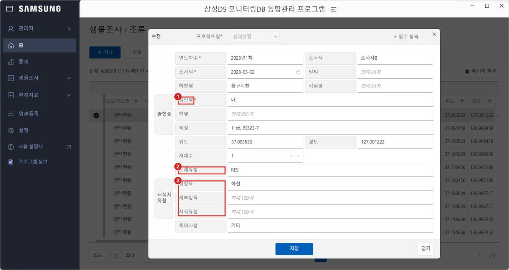

| 번호 | 설명 |
|---|---|
| ① | 출현종 |
| ② | 도래유형 |
| ③ | 서식지 유형(대항목 · 세부항목 · 서식유형) |

| 묶음 | 칸 · 입력 |
|---|---|
| 위쪽(묶음 없음) | 「연도차수」 · 「조사자」 · 「조사일」 · 「날씨」 · 「하천명」 · 「지점명」 |
| 출현종 | 「일반명」(필수) · 「학명」 · 「특징」 |
| 가운데(묶음 없음) | 「위도」 · 「경도」 · 「개체수」(1 이상 정수) · 「도래유형」(글) |
| 서식지 유형 | 「대항목」 · 「세부항목」 · 「서식유형」 — 글 |
| 아래 | 「특이사항」 |

- [저장] 은 공통 필수 칸(→ 1.5)에 더해 「일반명」 이 있어야 켜집니다.
- 도래유형 · 서식지 유형은 글 칸입니다. 넣은 글 그대로 저장됩니다.
- 일괄등록에서는 「서식유형」 이 번호(1 ~ 6 · 쉼표로 여러 개 · `3)` · `3.` 꼴 포함)로 들어오면 이름으로 바꿔 저장합니다 — 1 「번식확실」 · 2 「번식추측」 · 3 「월동확실」 · 4 「채식 및 휴식」 · 5 「소리」 · 6 「이동」. 번호가 아닌 글은 그대로 둡니다(→ 5.2).

## 3.4. 포유류

포유류 관찰 기록을 관리합니다. 기록 1건이 출현종 1종이고, 확인 방법 12가지(포획 ~ 기타)를 칸마다 숫자로 적습니다. 계산하는 칸은 없습니다.

### 목록

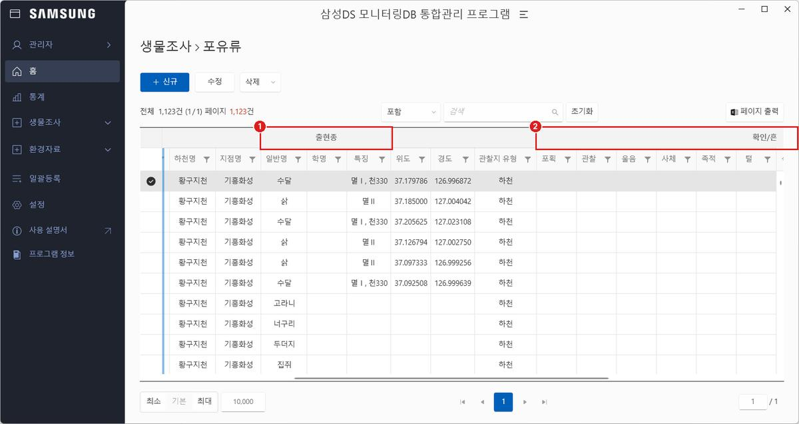

| 번호 | 설명 |
|---|---|
| ① | 출현종 |
| ② | 확인/흔적 유형 |

| 열 묶음 | 열 |
|---|---|
| (묶음 없음) | 조류와 같은 8열(→ 3.3) |
| 「출현종」 | 일반명 · 학명 · 특징 |
| (묶음 없음) | 위도 · 경도 · 관찰지 유형 |
| 「확인/흔적 유형」 | 포획 · 관찰 · 울음 · 사체 · 족적 · 털 · 식흔 · 굴 · 번식지 · 배설물 · 카메라 · 「기타(탐문 등)」 |
| (묶음 없음) | 조사자 · 특이사항 |

| 기능 | 설명 |
|---|---|
| [신규] | 자료 추가 — 빈 편집기를 엶 |
| [수정] | 선택된 자료 수정 — 고른 행을 편집기로 엶 |
| [삭제] | [선택 자료 삭제] · [페이지 자료 삭제](→ 1.4) |
| [페이지 출력] | 목록 페이지 엑셀 출력 |

### 편집기

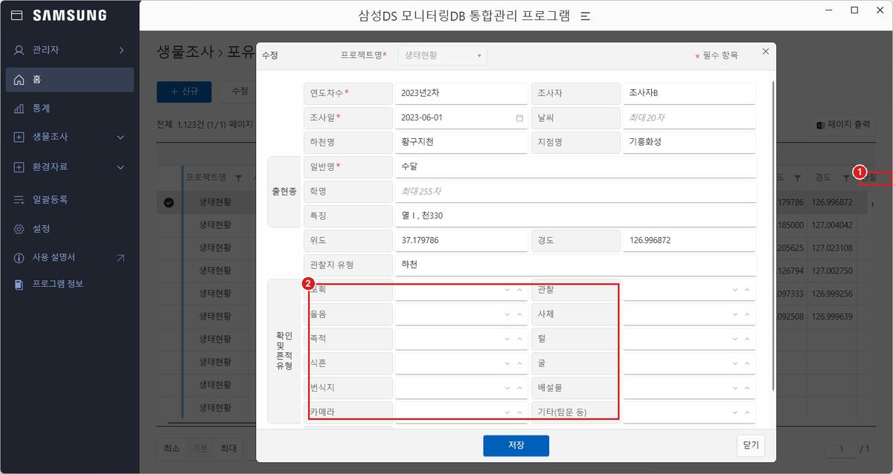

| 번호 | 설명 |
|---|---|
| ① | 관찰지 유형 |
| ② | 확인 및 흔적 12칸 |

| 묶음 | 칸 · 입력 |
|---|---|
| 위쪽(묶음 없음) | 조류와 같은 6칸(→ 3.3) |
| 출현종 | 「일반명」(필수) · 「학명」 · 「특징」 |
| 가운데(묶음 없음) | 「위도」 · 「경도」 · 「관찰지 유형」(글) |
| 확인 및 흔적 유형 | 「포획」 · 「관찰」 · 「울음」 · 「사체」 · 「족적」 · 「털」 · 「식흔」 · 「굴」 · 「번식지」 · 「배설물」 · 「카메라」 · 「기타(탐문 등)」 — 12칸 · 1 이상 정수 |
| 아래 | 「특이사항」 |

- [저장] 은 공통 필수 칸(→ 1.5)에 더해 「일반명」 이 있어야 켜집니다.
- 확인 및 흔적 12칸은 해당 없는 칸을 비워 둡니다. 빈칸은 빈칸 그대로 저장됩니다.
- 일괄등록에서 「관찰지 유형」 은 양식 S열에서 읽고, S열이 비면 R열에서 읽습니다(→ 5.2).

## 3.5. 양서파충류

양서파충류 관찰 기록을 관리합니다. 기록 1건이 출현종 1종이고, 관찰내용 6가지(성체 ~ 기타)를 칸마다 숫자로 적습니다. 계산하는 칸은 없습니다.

### 목록

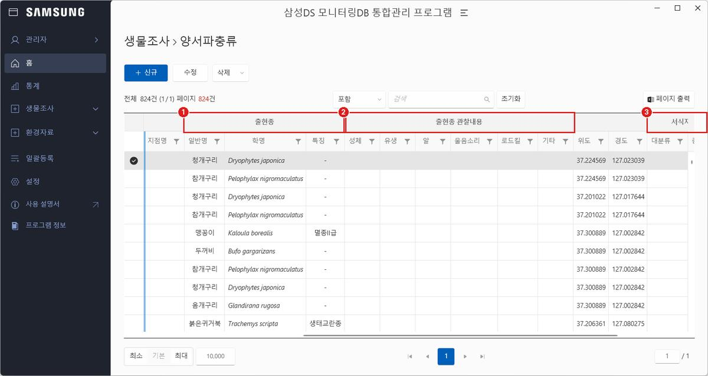

| 번호 | 설명 |
|---|---|
| ① | 출현종 |
| ② | 출현종 관찰내용 |
| ③ | 서식지 유형 |

| 열 묶음 | 열 |
|---|---|
| (묶음 없음) | 조류와 같은 8열(→ 3.3) |
| 「출현종」 | 일반명 · 학명 · 특징 |
| 「출현종 관찰내용」 | 성체 · 유생 · 알 · 울음소리 · 로드킬 · 기타 |
| (묶음 없음) | 위도 · 경도 |
| 「서식지 유형」 | 대분류 · 중분류 |
| (묶음 없음) | 조사자 · 특이사항 |

| 기능 | 설명 |
|---|---|
| [신규] | 자료 추가 — 빈 편집기를 엶 |
| [수정] | 선택된 자료 수정 — 고른 행을 편집기로 엶 |
| [삭제] | [선택 자료 삭제] · [페이지 자료 삭제](→ 1.4) |
| [페이지 출력] | 목록 페이지 엑셀 출력 |

### 편집기

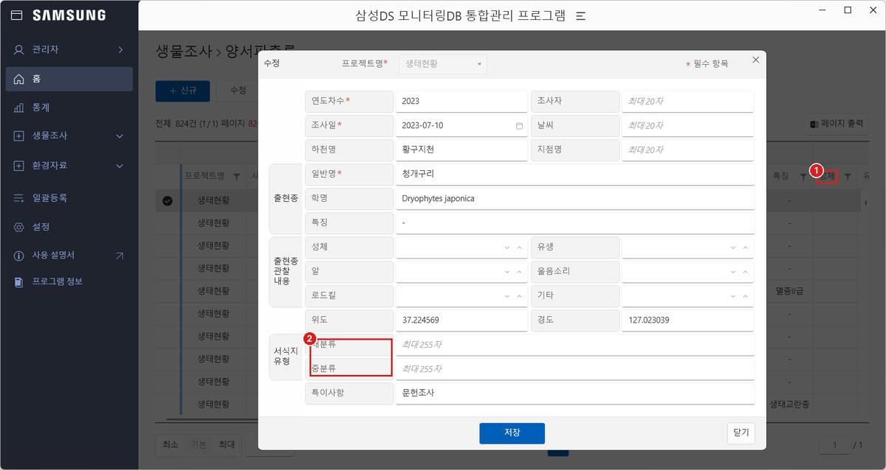

| 번호 | 설명 |
|---|---|
| ① | 관찰내용 6칸 |
| ② | 서식지 유형(대분류 · 중분류) |

| 묶음 | 칸 · 입력 |
|---|---|
| 위쪽(묶음 없음) | 조류와 같은 6칸(→ 3.3) |
| 출현종 | 「일반명」(필수) · 「학명」 · 「특징」 |
| 출현종 관찰내용 | 「성체」 · 「유생」 · 「알」 · 「울음소리」 · 「로드킬」 · 「기타」 — 6칸 · 1 이상 정수 |
| 가운데(묶음 없음) | 「위도」 · 「경도」 |
| 서식지 유형 | 「대분류」 · 「중분류」 — 글 |
| 아래 | 「특이사항」 |

- [저장] 은 공통 필수 칸(→ 1.5)에 더해 「일반명」 이 있어야 켜집니다.
- 관찰내용 6칸은 해당 없는 칸을 비워 둡니다.
- 관찰형 세 분류군의 일괄등록은 「항목 열 위치」 로 엑셀 열을 맞춥니다(→ 5.2).

# 4. 환경자료

주 메뉴 「환경자료」 에서 [서식수변] · [수질] 을 누르면 목록 화면이 열립니다. 두 화면 모두 기록 1건이 지점 · 연도차수의 평가 · 측정 1회이고, 출현종은 없습니다.

| 화면 | 넣는 것 | [저장] 할 때 계산 |
|---|---|---|
| 서식수변 | 평가항목 10 · 조사불가시 | 「평가점수」 · 「평가등급」 |
| 수질 | 측정항목 9 · 추가항목 14 | 수질등급 8 |

- 목록 단추 · 검색 · 삭제는 1.4, 편집기 공통 규칙은 1.5 와 같습니다.

## 4.1. 서식수변

서식 · 수변환경 평가 기록을 관리합니다. 평가항목 10개의 점수를 넣으면 [저장] 할 때 평가점수와 평가등급을 계산해 함께 저장합니다({{그림 4-2_habitat-editor}}).

### 목록

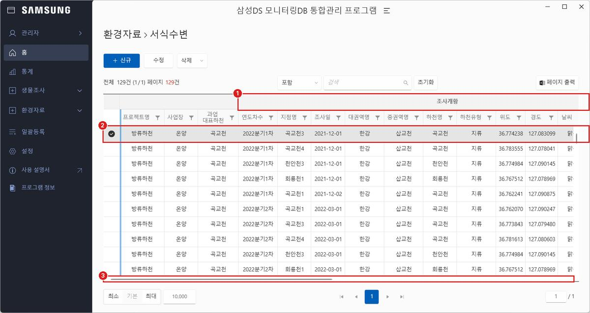

| 번호 | 설명 |
|---|---|
| ① | 조사개황 |
| ② | 고른 행 |
| ③ | 가로 스크롤 — 조사불가시 · 평가항목 · 평가점수 · 평가등급 |

| 열 묶음 | 열 |
|---|---|
| (묶음 없음) | 프로젝트명 · 사업장 · 과업 대표하천 |
| 「조사개황」 | 어류와 같은 12열(→ 3.1) |
| 「조사불가시」 | 조사불가시 · 특이사항 |
| 「평가항목」 | 10항목(아래 표) |
| (묶음 없음) | 「평가점수」 · 「평가등급」 |

| 기능 | 설명 |
|---|---|
| [신규] | 자료 추가 — 빈 편집기를 엶 |
| [수정] | 선택된 자료 수정 — 고른 행을 편집기로 엶 |
| [삭제] | [선택 자료 삭제] · [페이지 자료 삭제](→ 1.4) |
| [페이지 출력] | 목록 페이지 엑셀 출력 |

### 편집기

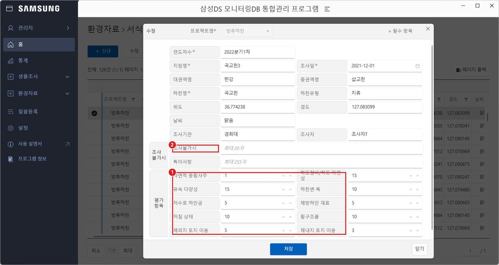

| 번호 | 설명 |
|---|---|
| ① | 평가항목 10 |
| ② | 조사불가시 |

| 묶음 | 칸 · 입력 |
|---|---|
| 위쪽(묶음 없음) | 조사개황 12칸(어류와 같음 · → 3.1) |
| 조사불가시 | 「조사불가시」 · 「특이사항」 — 글 |
| 평가항목 | 10칸 — 0 이상 숫자 · 칸에서 나가면 소수 1자리로 반올림 |

| 번호 | 평가항목 |
|---|---|
| 1 | 「자연적 종횡사주」 |
| 2 | 「하도정비/하도 자연성」 |
| 3 | 「유속 다양성」 |
| 4 | 「하천변 폭」 |
| 5 | 「저수로 하안공」 |
| 6 | 「제방하안 재료」 |
| 7 | 「저질 상태」 |
| 8 | 「횡구조물」 |
| 9 | 「제외지 토지 이용」 |
| 10 | 「제내지 토지 이용」 |

- 평가점수 · 평가등급은 편집기에 보이지 않습니다. [저장] 할 때 계산하고 목록에서 봅니다.
- [저장] 은 공통 필수 칸(→ 1.5)에 더해 「하천명」(*) 이 있어야 켜집니다.
- 하천명이 빈 옛 기록을 [수정] 으로 열면 알림 「하천명이 비어 있습니다. 하천명을 넣어야 저장할 수 있습니다.」 가 뜹니다. 다른 칸만 고칠 때도 하천명을 넣어야 저장됩니다.

### 평가점수 · 평가등급

- 「평가점수」 = 값을 넣은 항목의 합계 ÷ 2 · 소수 1자리 반올림입니다.
- 한 항목이라도 값이 있으면 점수를 냅니다. 10항목을 모두 0 으로 넣으면 0점 · E 입니다.
- 10항목이 모두 빈칸이면 평가점수 · 평가등급은 빈칸(미평가)입니다.
- 「평가등급」: A ≥80 · B ≥60 · C ≥40 · D ≥20 · 그 밖 E.
- 「조사불가시」 글(띄어쓰기 무시)에 `접근불가` 가 들어 있으면 평가등급은 `-` 입니다. 평가점수는 그대로 계산합니다. 건천화 · 준설 같은 다른 글은 등급에 영향이 없습니다.

> ⚠ 빈칸인 항목은 합계에 들어가지 않습니다. 10항목을 다 넣었는지 확인하고 [저장] 합니다.

> ⚠ 조사불가 판정이 어류 · 저서와 다릅니다. 어류 · 저서는 네 낱말 중 하나와 글자가 같아야 하고, 서식수변은 `접근불가` 가 글 안에 들어 있으면 됩니다.

## 4.2. 수질

수질 측정 기록을 관리합니다. 측정항목 9개 · 추가항목 14개를 넣으면 [저장] 할 때 측정항목 8개의 수질등급을 계산해 함께 저장합니다.

### 목록

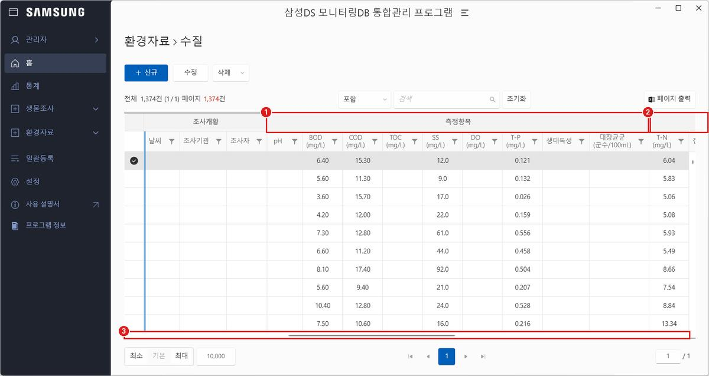

| 번호 | 설명 |
|---|---|
| ① | 측정항목 |
| ② | 추가항목 |
| ③ | 가로 스크롤 — 수질등급 |

| 열 묶음 | 열 |
|---|---|
| (묶음 없음) | 프로젝트명 · 사업장 · 과업 대표하천 |
| 「조사개황」 | 어류와 같은 12열(→ 3.1) |
| 「측정항목」 | 9항목(아래 표) |
| 「추가항목」 | 14항목(아래 표) |
| 「수질등급」 | 「pH 등급」 · 「BOD 등급」 · 「COD 등급」 · 「TOC 등급」 · 「SS 등급」 · 「DO 등급」 · 「T-P 등급」 · 「대장균군 등급」 |

| 기능 | 설명 |
|---|---|
| [신규] | 자료 추가 — 빈 편집기를 엶 |
| [수정] | 선택된 자료 수정 — 고른 행을 편집기로 엶 |
| [삭제] | [선택 자료 삭제] · [페이지 자료 삭제](→ 1.4) |
| [페이지 출력] | 목록 페이지 엑셀 출력 |

### 편집기

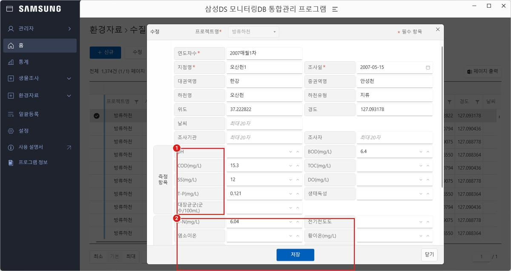

| 번호 | 설명 |
|---|---|
| ① | 측정항목 |
| ② | 추가항목 |

| 묶음 | 칸 · 입력 |
|---|---|
| 위쪽(묶음 없음) | 조사개황 12칸(어류와 같음 · → 3.1) |
| 측정항목 | 9칸 — 0 이상 숫자 |
| 추가항목 | 14칸 — 0 이상 숫자 |

| 측정항목 | 화면 자릿수 | 수질등급 |
|---|---|---|
| 「pH」 | 1 | 「pH 등급」 |
| 「BOD(mg/L)」 | 2 | 「BOD 등급」 |
| 「COD(mg/L)」 | 2 | 「COD 등급」 |
| 「TOC(mg/L)」 | 2 | 「TOC 등급」 |
| 「SS(mg/L)」 | 1 | 「SS 등급」 |
| 「DO(mg/L)」 | 2 | 「DO 등급」 |
| 「T-P(mg/L)」 | 3 | 「T-P 등급」 |
| 「생태독성」 | 1 | 없음 |
| 「대장균군(군수/100mL)」 | 1 | 「대장균군 등급」 |

| 추가항목 | 화면 자릿수 |
|---|---|
| 「T-N(mg/L)」 | 2 |
| 「전기전도도」 · 「염소이온」 · 「황이온(mg/L)」 | 1 |
| 「구리(mg/L)」 · 「아연(mg/L)」 · 「크롬(mg/L)」 | 3 |
| 「탁도」 · 「클로로필a(mg/m3)」 · 「수온」 · 「수심(cm)」 | 1 |
| 「유속(cm/s)」 | 2 |
| 「초당유량(m3/sec)」 | 3 |
| 「일당유량(m3/day)」 | 1 |

### 측정값 · 자릿수

- 측정값은 **넣은 값 그대로** 저장됩니다. 위 표의 자릿수는 목록 · 편집기 화면에 보이는 자릿수일 뿐입니다(예 `7.58` 은 화면에 `7.6` 으로 보이고 `7.58` 로 저장).
- 칸에서 나갈 때 반올림하는 칸은 「위도」 · 「경도」(소수 6자리)뿐입니다.
- 수질등급도 넣은 값(원값)으로 계산합니다.
- 예전 판에서 반올림되어 저장된 값은 그대로 남아 있습니다. 원본 엑셀을 다시 일괄등록해 같은 기록을 바꾸면 원값이 됩니다(→ 5.3).

### 수질등급

[저장] 할 때 측정항목 8개의 등급을 계산합니다. 값이 빈칸인 항목은 등급도 빈칸입니다. 「생태독성」 과 추가항목 14개는 등급이 없습니다.

| 항목 | 1a | 1b | 2 | 3 | 4 | 5 | 6 |
|---|---|---|---|---|---|---|---|
| BOD | ≤1 | ≤2 | ≤3 | ≤5 | ≤8 | ≤10 | >10 |
| COD | ≤2 | ≤4 | ≤5 | ≤7 | ≤9 | ≤11 | >11 |
| TOC | ≤2 | ≤3 | ≤4 | ≤5 | ≤6 | ≤8 | >8 |
| T-P | ≤0.02 | ≤0.04 | ≤0.1 | ≤0.2 | ≤0.3 | ≤0.5 | >0.5 |
| DO | ≥7.5 | ≥5 | — | — | ≥2 | — | <2 |
| 대장균군 | ≤50 | ≤500 | ≤1000 | ≤5000 | >5000 | — | — |

- pH 는 6.5 ~ 8.5 면 1, 그 밖은 4 입니다.
- SS 는 ≤25 면 1, ≤100 이면 4, 그 밖은 5 입니다.

### 검출한계 미만(ND · <값)

- 관리자 수질 자료에는 비고(특이사항) 칸이 없습니다. 측정 칸은 숫자만 받습니다.
- 검출한계 미만인 항목은 측정값 칸을 비워 둡니다. 그 항목 등급도 빈칸이 됩니다.
- 조사자 앱은 검출한계 미만을 측정 칸을 비우고 비고에 적습니다. 그 비고는 관리자 수질 자료에 들어오지 않고, 그 항목은 빈칸으로 남습니다(→ 5.6).

> ⚠ 검출한계 미만을 0 으로 넣지 않습니다. 0 은 측정값 0 으로 저장되고 등급도 0 으로 계산됩니다(예 BOD 0 → 1a).

# 5. 일괄등록

엑셀 파일(.xlsx)의 조사자료를 분류군별로 한 번에 DB 에 넣습니다. 조사자 앱이 만든 일괄입력용 파일도 그대로 넣습니다(→ 5.6). 순서는 분류군 단추(5.1) → 가져오기 · 검수 · 저장(5.2) → 목록 밖 종(5.4) · 같은 기록(5.3) → 저장 알림(5.5)입니다.

## 5.1. 일괄등록 화면

주 메뉴 또는 전체 메뉴 「기타」 의 [일괄등록] 을 누릅니다(→ 1.2 · {{그림 5-1_bulk}}).

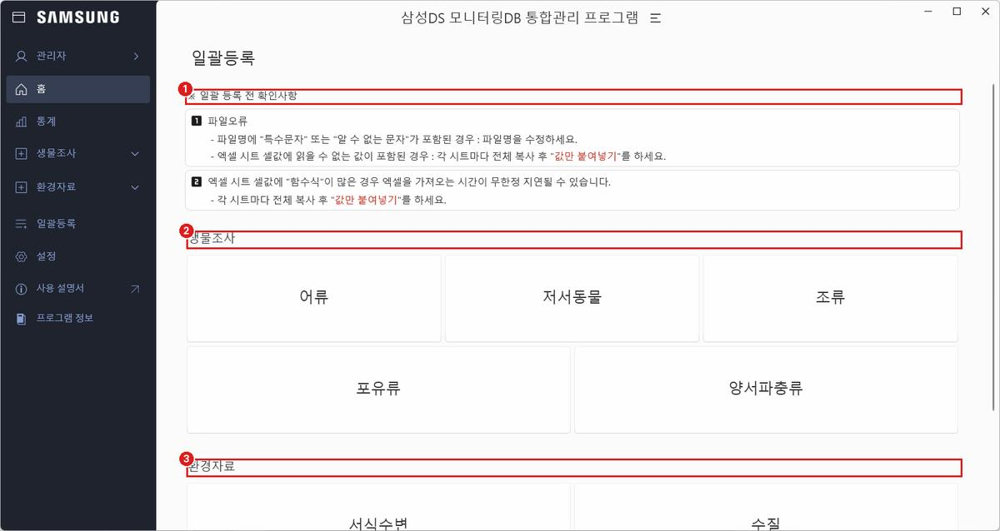

| 번호 | 설명 |
|---|---|
| ① | 일괄 등록 전 확인사항 |
| ② | 생물조사 5 |
| ③ | 환경자료 2 |

| 기능 | 설명 |
|---|---|
| 「생물조사」 | [어류] · [저서동물] · [조류] · [포유류] · [양서파충류] |
| 「환경자료」 | [서식수변] · [수질] |
| 분류군 단추 | 마우스를 올리면 「등록창 열기」 · 누르면 그 분류군의 일괄등록 창(→ 5.2) |

| 확인사항 | 할 일 |
|---|---|
| ① 「파일오류」 — 파일 이름에 특수문자 · 알 수 없는 문자 | 「파일명을 수정하세요.」 |
| ① 셀값에 「읽을 수 없는 값이 포함된 경우」 · ② 함수식이 많아 「가져오는 시간이 무한정 지연될 수 있습니다」 | 시트마다 전체 복사 후 「값만 붙여넣기」(원본은 두고 사본에서) |

- 일괄등록 창은 위쪽 제목 줄 오른쪽 × 로 닫습니다. 닫으면 가져온 자료는 비워집니다.

## 5.2. 일괄등록 창

아래는 어류 창입니다({{그림 5-2_bulk-fish}}). 다른 분류군도 같은 틀입니다(→ 5.6).

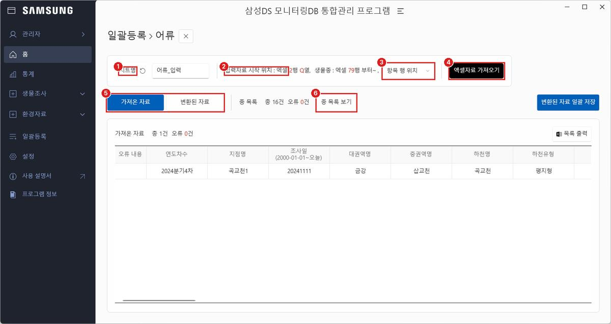

| 번호 | 설명 |
|---|---|
| ① | 시트명 |
| ② | 입력자료 시작 위치 · 생물종 행 |
| ③ | [항목 행 위치] |
| ④ | [엑셀자료 가져오기] |
| ⑤ | [가져온 자료] · [변환된 자료] |
| ⑥ | [종 목록 보기] |

| 기능 | 설명 |
|---|---|
| [시트명] · 시트명 칸 | 가져올 시트 · 분류군마다 기본값(→ 5.6) · 단추를 누르면 기본값으로 · 비면 가져오기 꺼짐 |
| 「입력자료 시작 위치 : 엑셀」 | 첫 자료의 행 · 열(빨간 글자) · 바꿀 수 없음 |
| 「생물종 : 엑셀」 · 「추가항목 : 엑셀」 | 어류 · 저서동물 종 행 · 수질 추가항목이 시작하는 행 — 시트 끝까지 읽음(→ 5.6) |
| [항목 행 위치] · [항목 열 위치] | 항목마다 읽는 엑셀 행 번호(열 글자) 목록 · 보기만 |
| [엑셀자료 가져오기] | 파일 고르기 → 읽기 · 변환 · 검수 |
| [가져온 자료] · [변환된 자료] | 두 표 켜고 끄기 · 처음엔 가져온 자료만 · 「총」 · 「오류」 건수 |
| 「종 목록」 · [종 목록 보기] | 어류 · 저서동물 종 행 건수 · 오류 · 값 다름(→ 5.5) · 목록 밖 종(→ 5.4) · 종 행 표 띄우기 |
| [목록 출력] | 그 표를 엑셀로 · 기본 이름 `어류_가져온자료_yyyyMMddHHmmss.xlsx` 등 |
| 「오류 내용」 | 기록마다 오류 문구 · 비면 정상 |
| [변환된 자료 일괄 저장] | DB 에 저장 · 오류 0건일 때만 켜짐 |

- 두 표는 스크롤 · 정렬 · 선택 행이 함께 움직입니다. 같은 줄이 같은 기록입니다.
- 기록 하나가 한 열(관찰형은 한 행)입니다. 첫 칸(연도차수)이 빈 열은 읽지 않고, 종 행은 개체수 칸에 숫자가 있는 행만 읽습니다.

### 가져오기

1. 시트명 칸이 파일의 시트 이름과 같은지 봅니다(띄어쓰기 · 대소문자 무시).
2. [엑셀자료 가져오기] 를 누르고 파일을 고릅니다.
3. 「오류」 가 0 이 아니면 「오류 내용」 을 보고 엑셀을 고친 뒤 다시 가져옵니다({{그림 5-3_bulk-errors}}).

| 창 | 문구 · 까닭 | 할 일 |
|---|---|---|
| [파일명 오류] | 파일 이름에 대분류 낱말이 없거나 둘 다 있음 | 파일 이름 고치기(→ 5.6) |
| [엑셀 시트명 오류] | 「엑셀 시트명 : {시트명}」 「을 찾을 수 없습니다.」 | 시트명을 고치거나 맞는 분류군 창에서 열기 |
| [가져오기 오류] | 「파일이 실행중인지 확인하세요」 | 엑셀에서 그 파일 닫기 |
| [가져오기 오류] | 「파일 변환 오류」 | 「값만 붙여넣기」 한 사본으로(→ 5.1) |

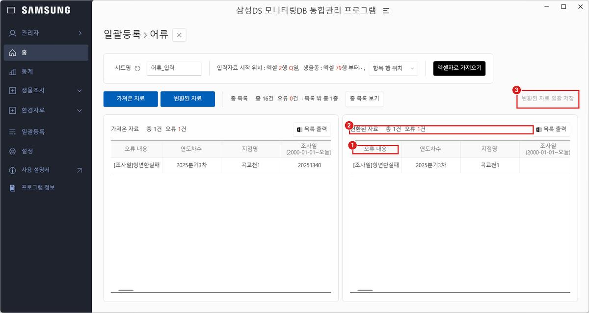

| 번호 | 설명 |
|---|---|
| ① | 오류 내용 |
| ② | 총 · 오류 건수 |
| ③ | [변환된 자료 일괄 저장] — 오류가 있으면 꺼짐 |

### 오류 문구

오류가 여럿이면 이어 붙입니다(예 `[조사일]형변환실패[지점명]목록없음`).

| 문구 | 뜻 |
|---|---|
| `[항목명]필수누락` | 꼭 있어야 할 칸이 빔 — 연도차수 · 조사일 · 방류하천 지점명 · 어류 하천차수 등 |
| `[항목명]형변환실패` | 날짜 · 숫자 · 좌표로 읽지 못함 · 조사일이 범위 밖 |
| `[연도차수]연도오류` | 연도차수 앞 4자리가 연도가 아니거나 2000년 ~ 올해 밖 |
| `[지점명]목록없음` | sites.json · 프로젝트 사업장 지점 어느 쪽으로도 지점을 찾지 못함(→ 5.6 · 6.1) |

- 어류 하천차수는 특이사항이 조사불가 네 낱말(접근불가 · 건천화 · 준설 · 공사중 · 띄어쓰기 무시) 중 하나이거나 출현 개체가 0 이면 비어도 됩니다. 특이사항에 다른 글만 있으면 `[하천차수]필수누락` 입니다(편집기와 같음 · → 3.1).
- 생태현황 파일은 지점명이 비어도 됩니다. 서식수변 하천명은 일괄등록에서는 비어도 저장되지만, 그 기록을 편집기에서 고치려면 하천명을 넣어야 합니다(→ 4.1).

### 저장 가능한 자료형

| 칸 | 받는 값 | 저장 |
|---|---|---|
| 조사일 | 날짜 · `20260415` · `260415` | 날짜 · 「(2000-01-01~오늘)」 만 |
| 연도차수 | 앞 4자리가 연도(예 `2026반기2차`) | 띄어쓰기를 뺀 글자 |
| 위도 · 경도 | 십진(`36.783486`) · 도분초(`36_47_00.5464` · `36°47’00.5464“`) | 십진 |
| 위도 · 경도(포유류 · 양서파충류) | 십진 칸 · 비면 도 · 분 · 초 칸 | 십진 |
| 번호로 적은 목록 값 | 날씨 `1` 맑음 · `2` 흐림 · `3` 비(눈) · 어류 채집도구 · 흐름상태 · 하천형태 등 | 이름 |
| 조류 서식유형 | `1` ~ `6`(`3)` · `3.` · 쉼표로 여러 개) | 번식확실 · 번식추측 · 월동확실 · 채식 및 휴식 · 소리 · 이동 |
| 빈 칸 | — | 빈 값(0 으로 채우지 않음) |

- 십진 좌표는 소수 6자리로 반올림합니다. 번호가 아닌 글자는 그대로 둡니다.

### 종 목록 보기(어류 · 저서동물)

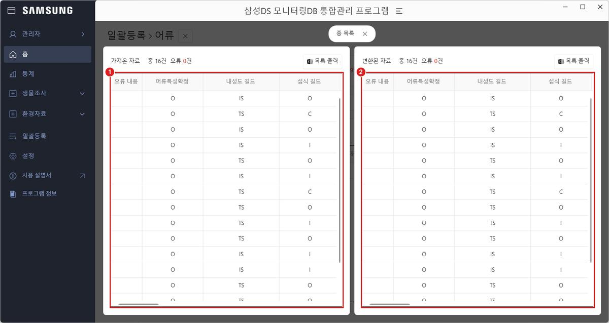

| 번호 | 설명 |
|---|---|
| ① | 가져온 종 목록 |
| ② | 변환된 종 목록(지표값 = 종목록) |

- [종 목록 보기] 로 띄웁니다({{그림 5-4_bulk-species}}). 변환된 종 목록의 지표값 · 길드는 관리자 종목록 값입니다(→ 5.5). 종 행에 오류가 있어도 저장이 꺼집니다.

### 저장

1. [변환된 자료 일괄 저장] → [자료 일괄 저장] 확인 창 [예].
2. 목록 밖 종이 있으면 [종목록에 없는 종이 있습니다] 창(→ 5.4).
3. DB 에 같은 기록이 있으면 [같은 기록이 있습니다] 창(→ 5.3).
4. 끝나면 저장 알림이 뜨고 창이 비워집니다(→ 5.5).

> ⚠ 오류가 1건이라도 있으면 저장하지 않습니다. 오류 행만 빼고 저장하는 방법은 없습니다.

## 5.3. 같은 기록이 있을 때

저장할 때 DB 에 같은 기록이 있는지 내용으로 봅니다. 있으면 하나씩 묻습니다({{그림 5-5_same-record}}).

| 분류군 | 같은 기록 |
|---|---|
| 어류 · 저서동물 · 서식수변 · 수질 | 대분류 · 지점 · 연도차수 · 조사일이 같은 기록 1건 |
| 조류 · 포유류 · 양서파충류 — 방류하천 | 대분류 · 지점 · 연도차수 · 조사일이 같은 행 묶음 |
| 조류 · 포유류 · 양서파충류 — 생태현황 | 위에 하천까지 같은 행 묶음 |

- 대분류는 파일 이름으로 정해지고(→ 5.6) DB 의 같은 대분류 기록만 견줍니다. 지점 · 연도차수 · 하천은 띄어쓰기 · 대소문자를 보지 않고, 조사일은 날짜만 봅니다.

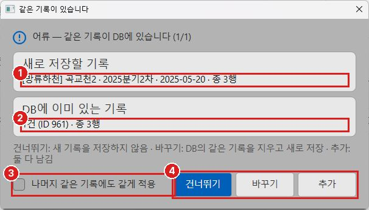

| 번호 | 설명 |
|---|---|
| ① | 새로 저장할 기록 |
| ② | DB에 이미 있는 기록 |
| ③ | 「나머지 같은 기록에도 같게 적용」 |
| ④ | [건너뛰기] · [바꾸기] · [추가] |

| 기능 | 설명 |
|---|---|
| 「DB에 이미 있는 기록」 | 건수 · ID · 종 행 수 · 여러 건이면 「[바꾸기]는 모두 지웁니다」 |
| 알림 줄 | 관찰형 방류하천에서 하천 표기가 다를 때만 「기존 하천: {하천} · 새 파일: {하천}」 |
| [건너뛰기] | 새 기록을 저장하지 않음 · 기본(**Enter**) · 창 닫기(×)도 같음 |
| [바꾸기] | DB 의 같은 기록(종 행 포함)을 지우고 새로 저장 |
| [추가] | 둘 다 남김 |
| 「나머지 같은 기록에도 같게 적용」 | 켜고 고르면 남은 같은 기록은 묻지 않음 |

> ⚠ [바꾸기] 로 지운 기록은 되돌릴 수 없습니다. 많이 바꿀 때는 먼저 `SDSMDB.sqlite` 를 복사해 둡니다(→ 9.2).

### 저장 알림 · 결과 창

| 경우 | 알림 |
|---|---|
| 바꾸거나 건너뛴 것이 없음 | 「자료가 저장되었습니다.」 |
| 바꾸거나 건너뛴 것이 있음 | 「저장 {n} · 바꿈 {n} · 건너뜀 {n}건」 — 저장 = 새로 저장 + [추가] |
| 모두 건너뜀 | 「저장한 자료가 없습니다(모두 건너뜀)」 |

같은 기록이 하나라도 있었으면 [같은 기록 처리 결과] 창이 뜹니다.

> 「새로 저장 : {n}건」 · 「바꿔 저장 : {n}건」 · 「건너뜀 : {n}건」 · 「(같은 기록이 있는데 추가 : {n}건)」

- 「같은 기록을 확인하는 중 오류가 발생하였습니다.」 · 「저장 중 오류가 발생하였습니다.」 가 뜨면 로그를 봅니다(→ 9.3).

### 같은 이름의 파일

같은 분류군에서 전에 저장한 파일과 이름이 같으면(띄어쓰기 · 대소문자 무시) 파일을 고를 때 알립니다. 막지는 않습니다.

> 「같은 이름의 파일을 저장한 기록이 있습니다({날짜 시각}). 같은 기록인지는 저장할 때 내용으로 확인합니다.」

## 5.4. 종목록에 없는 종이 있을 때

어류 · 저서동물 종 행에 관리자 종목록에 없는 종이 있으면 저장 때 이 창이 먼저 뜹니다({{그림 5-6_unlisted-species}}). 국명과 학명이 함께 맞아야 목록 종이고(띄어쓰기 · 대소문자 무시), 예전 학명은 지침 표기로 바꿔 견줍니다.

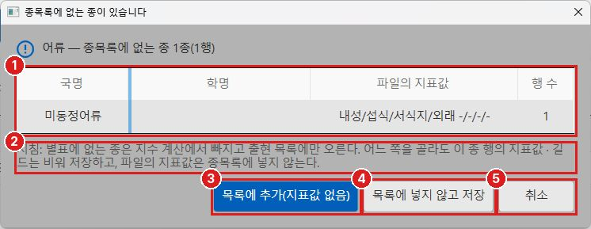

| 번호 | 설명 |
|---|---|
| ① | 목록 밖 종 · 파일의 지표값 · 행 수 |
| ② | 지침 안내 |
| ③ | [목록에 추가(지표값 없음)] |
| ④ | [목록에 넣지 않고 저장] |
| ⑤ | [취소] |

| 기능 | 설명 |
|---|---|
| [목록에 추가(지표값 없음)] | 기록 저장 + 이 종들을 종목록에 지표값 · 길드 없이 더함 · 분류(강 · 목 · 과 등)는 파일 값 · 저장된 기록이 1건 이상일 때만 |
| [목록에 넣지 않고 저장] | 기록만 저장 · 종목록 그대로 |
| [취소] | 저장하지 않음 · **Esc** · 창 닫기(×)도 같음 |

> 「지침: 별표에 없는 종은 지수 계산에서 빠지고 출현 목록에만 오른다. 어느 쪽을 골라도 이 종 행의 지표값 · 길드는 비워 저장하고, 파일의 지표값은 종목록에 넣지 않는다.」

- 그 종 행은 지표값 · 길드가 빈 채 출현 목록에 남습니다. 비운 칸은 FAI · BMI 의 그 항목에 들어가지 않고, 종 수 · 개체수에는 셉니다.
- 목록에 더한 종은 다음 파일부터 목록 종입니다. 파일에 지표값이 있으면 「값 다름」 으로 알립니다(→ 5.5).

> ⚠ 이름을 잘못 적은 종도 목록 밖 종으로 뜹니다. 목록에 더하면 틀린 이름이 종목록에 남으므로, 오타면 [취소] 하고 엑셀을 고칩니다.

## 5.5. 지표값 출처 · 저서 하상 옮김

### 지표값 출처 = 종목록

어류 · 저서동물 종 행의 아래 칸은 파일 값이 아니라 관리자 종목록 값으로 저장하고, FAI · BMI 도 이 값으로 계산합니다(→ 3.1 · 3.2 · 부록 C). 그 밖의 칸(고유종 · 멸종위기 · 목 · 과 등)은 파일 값입니다.

| 분류군 | 종목록 값으로 바꾸는 칸 |
|---|---|
| 어류 | 「어류특성확정」 · 「내성도 길드」 · 「섭식 길드」 · 「서식지 길드」 · 「외래종」 |
| 저서동물 | 「오탁치(s)」 · 「지표가중치(g)」 |

- 파일 값이 다른 종이 있으면 「종 목록」 줄 · 알림에 「{n}종 값 다름 → 종목록 값 사용」 이 붙습니다. 막지 않습니다. 글자에 마우스를 올리면 종마다 내용이 보입니다(예 `피라미 Zacco platypus: 파일 TS/O/-/- → 종목록 IS/O/-/-`).

### 저서 하상 암반 · 콘크리트

저서동물 하상은 지침 6칸(진흙 이하 · 모래 · 왕모래 · 자갈 · 작은돌 · 큰돌 이상)입니다. 파일의 암반 · 콘크리트 값은 두 칸에 저장하지 않고 「특이사항」 끝에 옮겨 적습니다(→ 3.2). 어류 하상(8칸)은 그대로 저장합니다.

> 「하상 암반 {n}% · 콘크리트 {n}%(지침 저서 하상 6칸 밖 · 옮김)」

- 0 보다 큰 숫자는 `n%`(소수점 아래 버림), 0 · 빈칸 · `-` · `N/A` 는 버리고, 그 밖의 글자는 `「원문」` 그대로 적습니다. 특이사항이 있으면 ` / ` 뒤에 붙입니다.
- 가져올 때 「하상 암반·콘크리트 값 {n}건을 특이사항으로 옮겼습니다(지침 저서 하상 6칸 밖)」 알림이 뜹니다. 오류로 막지 않습니다.

### 저장 알림

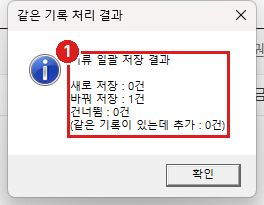

| 번호 | 설명 |
|---|---|
| ① | 저장 · 바꿈 · 건너뜀 건수와 확인할 것 |

5.3 의 알림 뒤에 확인할 것이 ` · ` 로 붙습니다({{그림 5-7_save-result}}). 새로 저장하거나 바꾼 기록이 있을 때만입니다.

- 어류 · 저서동물: 「{n}종 값 다름 → 종목록 값 사용」 · 「목록 밖 종 {n}종(지표값 · 길드 비움)」
- 저서동물: 「하상 암반·콘크리트 → 특이사항 {n}건」

## 5.6. 조사자 일괄입력용 파일

조사자 앱이 만든 일괄입력용 파일은 관리자 양식과 시트 이름이 같아 시트명을 바꾸지 않고 가져옵니다(조사자 사용설명서 8장).

| 항목 | 내용 |
|---|---|
| 파일 이름 | `{대분류}_{연도차수}_{지점}_{분류군}_DB_v1.xlsx` |
| 예 | `방류하천_2026반기2차_곡교천1_어류_DB_v1.xlsx` |

### 대분류 판별 — 파일 이름

파일 이름(띄어쓰기 무시)에 「생태현황」 · 「방류하천」 중 하나만 있어야 합니다. 그 파일의 모든 기록이 그 대분류로 저장됩니다.

| 파일 이름 | [파일명 오류] 문구 |
|---|---|
| 둘 다 없음 | 「파일명에 '생태현황' 또는 '방류하천'이 포함되어 있지 않습니다.」 |
| 둘 다 있음 | 「파일명에 '생태현황'과 '방류하천'이 둘 다 포함되어 있습니다.」 |

- 분류군은 누른 단추로 정해집니다. 다른 분류군 파일을 열면 [엑셀 시트명 오류] 가 뜹니다.

> ⚠ 파일 이름의 대분류 낱말을 지우거나 바꾸지 않습니다.

### 지점 찾기 — sites.json 먼저

1. 실행 폴더 sites.json(→ 6.2)에서 대분류 · 지점명 · 연도 구간(연도차수 앞 4자리)이 맞는 지점을 찾고, 그 사업장 · 과업대표하천 · 지점그룹에 맞는 프로젝트 사업장 지점(→ 6.1)으로 정합니다.
2. sites.json 에 없는 지점만 포함 규칙을 씁니다 — 방류하천은 지점명이 프로젝트 사업장 지점의 「지점명」 을 포함하면 그 지점(예 `오산천01` → `오산천`), 생태현황은 생태현황 구분 하나.
3. 둘 다 안 되면 `[지점명]목록없음` 입니다.

- 지점명은 띄어쓰기 · 대소문자를 보지 않습니다. [마스터 저장] 한 sites.json 은 다음 가져오기부터 바로 씁니다.

### 조사자 앱과 맞춰 둘 것

| 맞출 것 | 관리자에서 | 맞지 않으면 |
|---|---|---|
| 지점 목록 | [내보내기 (JSON)] (→ 6.2) | 목록 밖 지점명은 포함 규칙으로만 맞추거나 `[지점명]목록없음` |
| 종목록 | [종목록 내보내기 (species.json)] (→ 6.3) | 조사자 화면 FAI · BMI 가 관리자와 다를 수 있음 · 「값 다름」 · 목록 밖 종 창 |
| 이상치 기준 | [기준자료 내보내기 (JSON)] (→ 6.3) | 조사자 경고만 달라짐 |
| 조사자 앱 판 | 종목록 교체는 v0.5.0 이상 · 파일 이름에 연도차수가 든 판 | 연도차수 없는 옛 이름은 다른 차수와 이름이 같아 같은 이름 알림(→ 5.3) |

### 분류군별 시트 · 시작 위치

| 분류군 | 기본 시트명 | 입력자료 시작 | 종 · 추가항목 | 항목 위치 |
|---|---|---|---|---|
| 어류 | `어류_입력` | 2행 Q열 | 생물종 79행부터 | [항목 행 위치] |
| 저서동물 | `입력` | 2행 M열 | 생물종 47행부터 | [항목 행 위치] |
| 조류 · 포유류 · 양서파충류 | `조류` · `포유류` · `양서파충류` | 5행 B열 | — | [항목 열 위치] |
| 서식수변 | `서식 및 수변환경` | 2행 F열 | — | [항목 행 위치] |
| 수질 | `수질` | 2행 F열 | 추가항목 23행부터 | [항목 행 위치] |

### 다른 분류군의 일괄등록 창

수질 창({{그림 5-8_bulk-water}})의 추가항목은 시작 행부터 C · D 열 항목 이름(예 `TN` · `전기전도도` · `수온` · `유속`)이 맞는 행의 값을 가져옵니다.

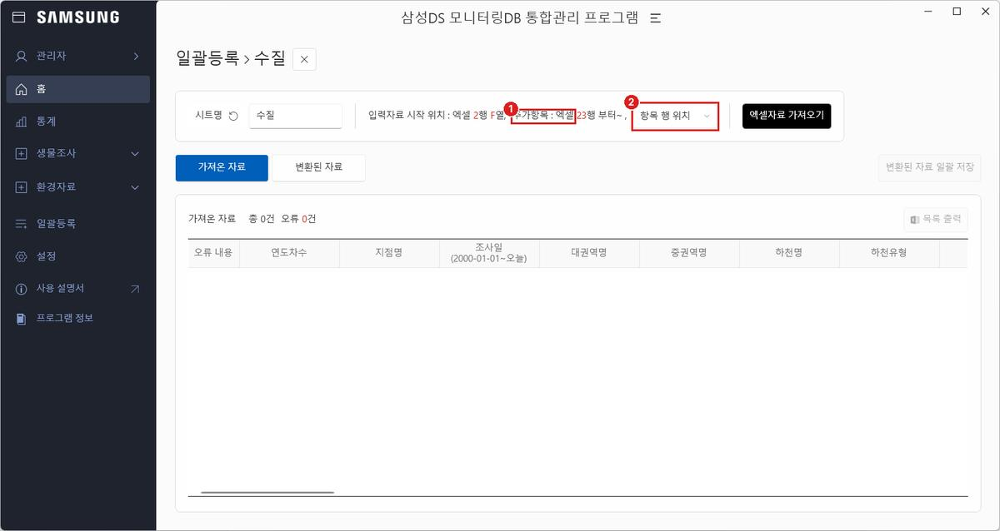

| 번호 | 설명 |
|---|---|
| ① | 추가항목 엑셀 행 |
| ② | [항목 행 위치] |

관찰형 창은 [항목 열 위치] 에 「항목명」 · 「열 위치」 가 펼쳐지고({{그림 5-9_bulk-bird}}), 종 목록 단추가 없습니다.

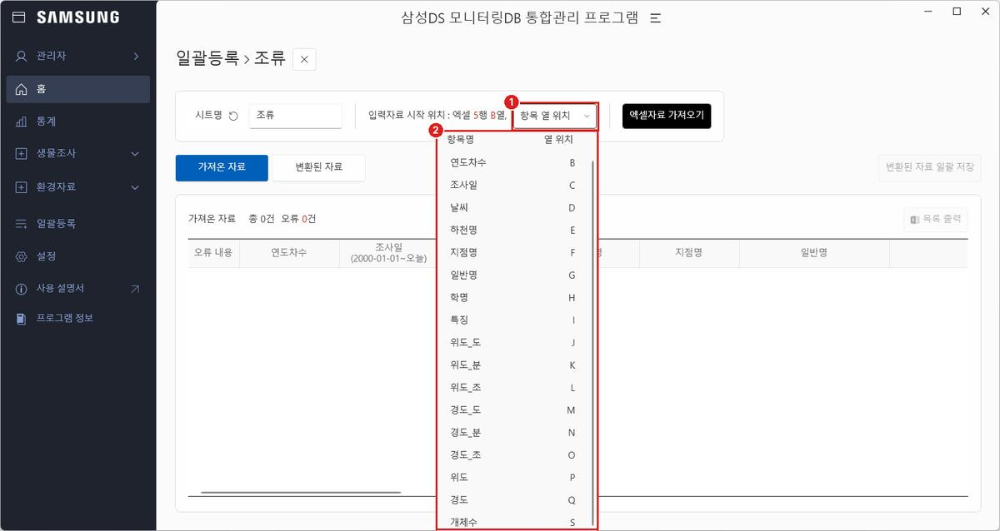

| 번호 | 설명 |
|---|---|
| ① | [항목 열 위치] |
| ② | 항목명 · 열 위치 |

# 6. 설정

주 메뉴 또는 전체 메뉴 「기타」 의 [설정] 을 누릅니다. 사업장 지점 구분(DB · 6.1) · 지점 마스터 sites.json(6.2) · 조사자 앱에 줄 기준자료(6.3) 세 구역입니다({{그림 6-1_settings}}).

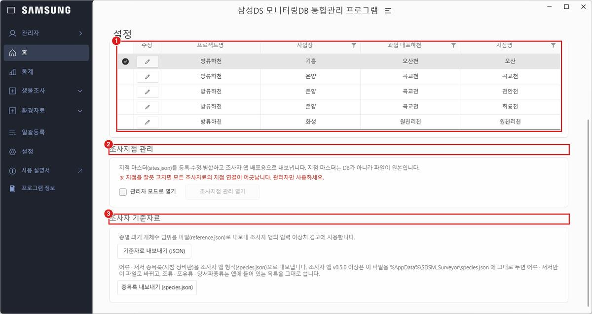

| 번호 | 설명 |
|---|---|
| ① | 프로젝트 사업장 지점(목록 — 위로 스크롤하면 입력 칸) |
| ② | 조사지점 관리 |
| ③ | 조사자 기준자료 |

## 6.1. 프로젝트 사업장 지점

방류하천 조사자료를 사업장 · 과업 대표하천으로 묶는 구분입니다. 조사자료마다 구분 하나가 연결되고, 일괄등록이 이 구분으로 지점을 정합니다(→ 5.6 · {{그림 6-2_site-division-edit}}).

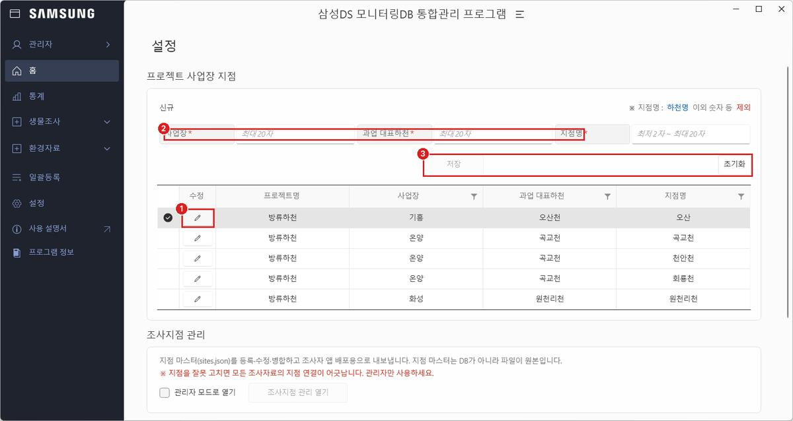

| 번호 | 설명 |
|---|---|
| ① | 수정(연필) |
| ② | 사업장 · 과업 대표하천 · 지점명 |
| ③ | [저장] · [초기화] |

| 기능 | 설명 |
|---|---|
| 제목 | 「신규」 또는 「수정 ({사업장}-{과업 대표하천}-{지점명})」 |
| 「사업장」 · 「과업 대표하천」 · 「지점명」 | 모두 필수(*) · 지점명 「최저 2자 ~ 최대 20자」 |
| [저장] | 새로 넣기 · 고친 것 저장 · 세 칸이 차고 지점명 2자 이상일 때 켜짐 |
| [초기화] | 칸 비우기 · 「신규」 로 |
| 목록 「수정」(연필) | 그 행을 위 칸으로 불러오기 |

- 목록에는 방류하천 구분만 보입니다. 새로 넣는 구분은 방류하천으로 저장되고, 생태현황 자료는 생태현황 구분 하나로 묶입니다. 지우는 단추는 없습니다.

### 지점명 규칙

「지점명」 칸에는 조사자료 지점명에 공통으로 든 하천명만 적습니다(화면 안내 '지점명 : 하천명 이외 숫자 등 제외').

| 조사자료 지점명 | 「지점명」 칸 |
|---|---|
| `오산천01` · `오산천02` … | `오산천` |
| `오산구간1` · `오산구간2` … | `오산` 또는 `오산구간` |

- 일괄등록은 sites.json 으로 먼저 맞추고, 목록에 없는 지점만 이 지점명이 들어 있는지로 맞춥니다(→ 5.6).

### 넣기 · 고치기

1. 새로 넣을 때는 세 칸을 적고 [저장] 합니다. 같은 구분이 있으면 [자료 중복] 「이미 존재하는 사업장-과업 대표하천-지점명입니다.」 가 뜹니다.
2. 고칠 때는 목록 행의 연필을 누릅니다. 「※ 수정 내용이 저장이 되면 모든 자료에 일괄 적용됩니다.」 가 보입니다.
3. 칸을 고치고 [저장] → [자료 수정] 확인 창 「수정 내용이 저장 후 모든자료의 관련 자료도 함께 변경됩니다.」 에서 [확인].

- 이 구분에 연결된 모든 조사자료의 사업장 · 과업 대표하천 · 지점명이 함께 바뀝니다.

> ⚠ sites.json 으로 맞출 때는 sites.json 지점의 사업장 · 과업대표하천과 이 구분의 글자가 같아야 합니다(띄어쓰기 · 대소문자 무시). 여기서 바꾸면 [조사지점 관리] 의 지점도 같게 고칩니다(→ 6.2).

## 6.2. 조사지점 관리

지점 마스터 sites.json 을 고치는 창입니다. 원본은 DB 가 아니라 실행 폴더의 파일이고, 이 창은 DB 에 쓰지 않습니다.

> 「※ 지점을 잘못 고치면 모든 조사자료의 지점 연결이 어긋납니다. 관리자만 사용하세요.」

1. [설정] 「조사지점 관리」 구역에서 「관리자 모드로 열기」 를 켭니다. 비밀번호를 묻지 않는, 잘못 여는 것을 막는 잠금입니다.
2. [조사지점 관리 열기] 를 누릅니다({{그림 6-3_site-master}}). 열 때마다 sites.json 을 새로 읽습니다.

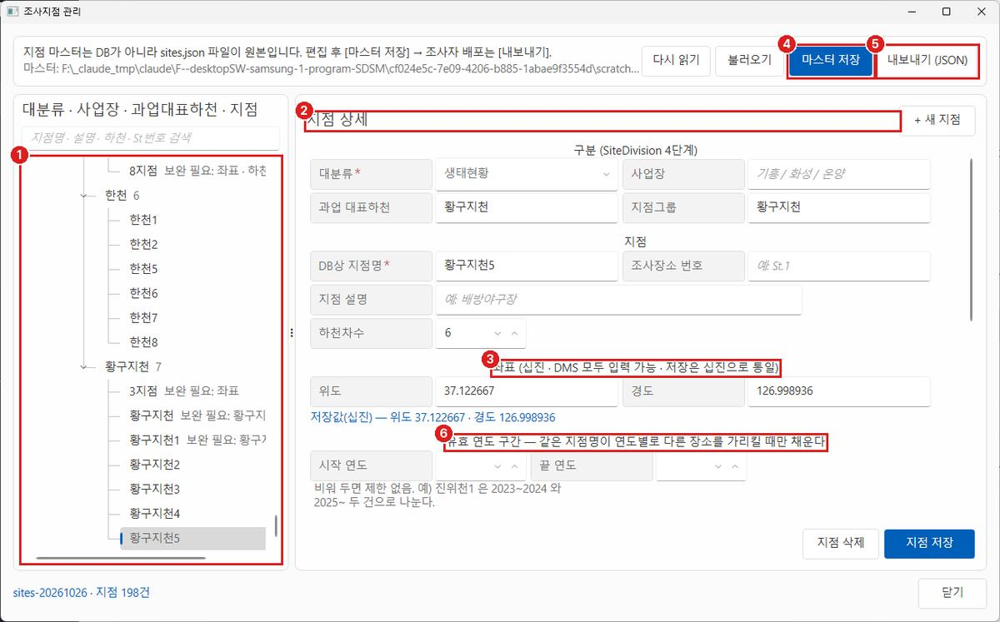

| 번호 | 설명 |
|---|---|
| ① | 대분류 · 사업장 · 과업대표하천 · 지점 트리 |
| ② | 지점 상세 |
| ③ | 좌표(십진 · DMS) |
| ④ | [마스터 저장] |
| ⑤ | [내보내기 (JSON)] |
| ⑥ | 유효 연도 구간 |

| 기능 | 설명 |
|---|---|
| [다시 읽기] | 파일을 다시 읽음 · 저장 안 한 고침은 버려짐 |
| [불러오기] | 다른 sites.json(조사자 앱 번들 등)을 작업본으로 · 「(아직 저장 전)」 |
| [마스터 저장] | 실행 폴더 sites.json 에 씀 · 판이 그날 `sites-yyyyMMdd` 로 |
| [내보내기 (JSON)] | 조사자 배포용 사본 · 기본 이름 `sites.json` |
| 트리 · 검색 칸 | 4단계 · 숫자는 지점 수 · 「지점명 · 설명 · 하천 · St번호 검색」 |
| [+ 새 지점] · [지점 저장] · [지점 삭제] | 빈 지점(고른 지점의 대분류 ~ 지점그룹을 물려받음) · 상세 칸을 작업본에 반영 · 작업본에서 지움 |
| 「구분 (SiteDivision 4단계)」 | 「대분류」 · 「사업장」 · 「과업 대표하천」 · 「지점그룹」 — 프로젝트 사업장 지점과 맞추는 값 |
| 「지점」 | 「DB상 지점명」(조사자료 지점명과 같은 글) · 「조사장소 번호」 · 「지점 설명」 · 「하천차수」 · 「적용 분류군」 |
| 좌표 | 십진 `37.2122527` 또는 DMS `37_12_44.11` · 「저장값(십진)」 미리보기 · 소수 6자리로 저장 |

상세 칸 아래쪽은 스크롤해서 봅니다({{그림 6-4_site-master-lower}}).

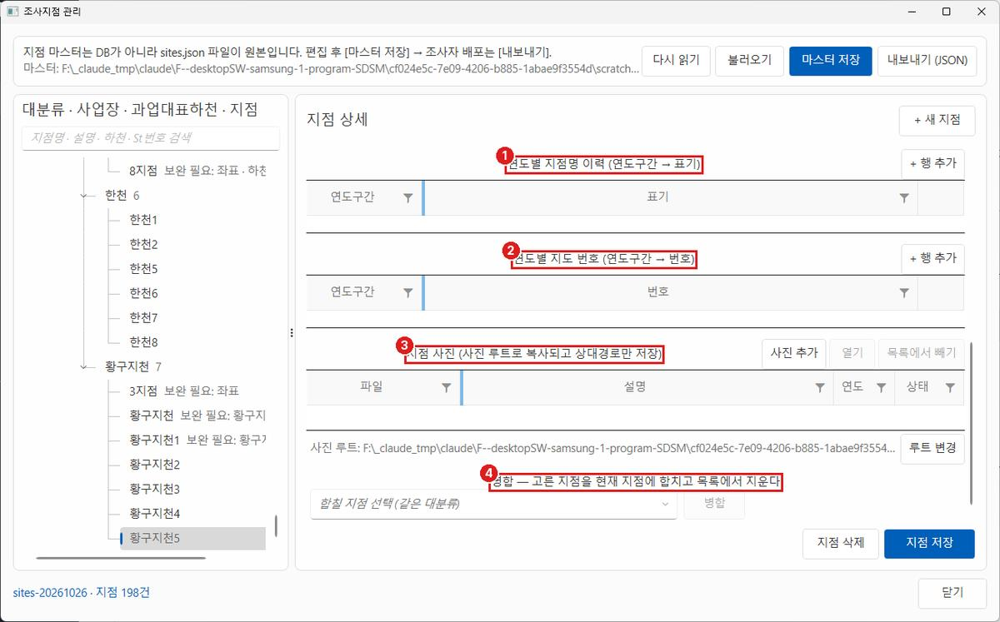

| 번호 | 설명 |
|---|---|
| ① | 연도별 지점명 이력 |
| ② | 연도별 지도 번호 |
| ③ | 지점 사진 |
| ④ | 병합 |

| 기능 | 설명 |
|---|---|
| 유효 연도 구간 | 「시작 연도」 · 「끝 연도」(2000 ~ 2100) · 비우면 제한 없음 |
| 지점명 이력 · 지도 번호 | 연도 구간마다 보고서 표기 · 지도 번호 · [+ 행 추가] · [삭제] |
| 지점 사진 | [사진 추가] · [열기] · [목록에서 빼기] · 「사진 루트」 · [루트 변경] |
| 병합 | 「합칠 지점 선택 (같은 대분류)」 → [병합] |

### 지점 고치기

1. 트리에서 지점을 고르고 상세 칸을 고칩니다.
2. [지점 저장] → 「반영됨 — 파일에 남기려면 [마스터 저장]을 누르세요.」
3. [마스터 저장] → 「저장됨 — {판} · 지점 {n}건」

- 같은 대분류 · 같은 지점명에 연도 구간이 겹치면 [지점 중복] 「같은 대분류에 '{지점}' 지점이 이미 있고 연도 구간이 겹칩니다.」 가 뜹니다.
- [지점 삭제] · [병합] · [불러오기] 도 [마스터 저장] 해야 파일에 남습니다.

> ⚠ [마스터 저장] 없이 [닫기] 하면 고친 것은 파일에 남지 않습니다. 묻지 않고 닫힙니다.

### 지점명을 바꾸지 않는 까닭

「DB상 지점명」 은 조사자료의 지점명 값이고, 일괄등록이 이 글자로 지점을 찾습니다(→ 5.6). 바꾸면 이미 저장된 조사자료 · 조사자 파일의 지점명과 맞지 않습니다.

| 경우 | 하는 일 |
|---|---|
| 보고서 표기만 바뀜 | 「연도별 지점명 이력」 에 구간과 표기(예 `22~25` → `곡교천-1`) |
| 같은 지점명이 연도에 따라 다른 장소 | 지점을 나누고 「유효 연도 구간」 — 「진위천1 은 2023~2024 와 2025~ 두 건으로 나눈다.」 |
| 같은 장소가 두 이름 | [병합] |

### 사진 · 병합 · 보내기

- [사진 추가] 는 사진을 「사진 루트」(기본 실행 폴더 `SitePhotos\`) 아래 `{대분류}\{지점명}\` 로 복사하고 sites.json 에는 상대 경로만 적습니다. [목록에서 빼기] 는 파일을 지우지 않습니다. 파일이 없으면 「(파일 없음)」 이 보입니다.
- [병합] 은 지금 지점에 고른 지점을 합치고 그 지점을 지웁니다. 「빈 항목만 채우고 분류군·연도이력·사진은 합칩니다.」 값이 있는 칸은 덮어쓰지 않습니다.
- [내보내기 (JSON)] 로 만든 sites.json 은 조사자가 앱을 닫고 `%AppData%\SDSM_Surveyor\` 에 복사한 뒤 다시 켭니다(조사자 사용설명서 9.2).

> ⚠ 새 판의 덮어쓰기용 압축에는 sites.json 이 들어 있어, 풀면 이 창에서 고친 지점(좌표 · 연도 구간 · 이력 · 지도 번호 · 사진 경로)이 사라집니다. 덮기 전에 sites.json 을 복사해 둡니다(→ 9.2). 고친 지점을 되살리려면 설치 뒤 [불러오기] 로 복사본을 읽고 [마스터 저장] 합니다 — 이때 새 판에 들어 있던 지점 정보도 복사본 내용으로 바뀝니다. 고친 적이 있는지는 상태 줄의 판(`sites-yyyyMMdd`)이 새 판에 든 판과 다른지로 봅니다.

## 6.3. 조사자 기준자료 · 종목록 내보내기

조사자 앱이 입력을 돕고 검사할 때 쓰는 파일을 관리자 DB 에서 만듭니다. 두 단추 모두 저장 위치를 고른 뒤 결과 창을 [확인] 으로 닫습니다.

| 기능 | 설명 |
|---|---|
| [기준자료 내보내기 (JSON)] | `reference.json` — 어류 · 저서동물 종(국명)별 과거 개체수 기록 수 · 최소 · 최대 · 판 `yyyyMMdd-HHmm` |
| [종목록 내보내기 (species.json)] | `species.json` — 어류 · 저서동물 종목록 · 판 `jichim2026-30+admin-yyMMdd` |

### 기준자료(reference.json)

> 「종별 과거 개체수 범위를 파일(reference.json)로 내보내 조사자 앱의 입력 이상치 경고에 사용합니다.」

- 개체수 1 이상 · 국명이 있는 종 행만 셉니다. [기준자료 내보내기] 창에 종 수와 「조사자 PC의 %AppData%\SDSM_Surveyor\reference.json 위치에 배포하세요.」 가 보입니다.
- 조사자 앱은 과거 기록이 없거나 과거 최대를 넘는 개체수에 경고만 띄웁니다(조사자 사용설명서 9.3).

### 종목록(species.json)

저장하면 판 · 종 수와 안내 글이 담긴 창이 뜹니다({{그림 6-5_species-export}}).

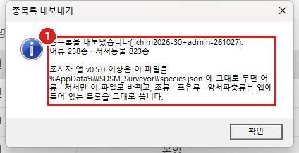

| 번호 | 설명 |
|---|---|
| ① | 판 · 종 수 · 조사자 앱 안내 |

> 「종목록을 내보냈습니다({판}).」 · 「어류 {n}종 · 저서동물 {n}종」
>
> 「조사자 앱 v0.5.0 이상은 이 파일을 %AppData%\SDSM_Surveyor\species.json 에 그대로 두면 어류 · 저서만 이 파일로 바뀌고, 조류 · 포유류 · 양서파충류는 앱에 들어 있는 목록을 그대로 씁니다.」

- 파일에는 어류 · 저서동물만 들어 있습니다. 같은 안내 글이 설정 화면 단추 위에도 있습니다.
- [프로그램 정보] 창의 [종목록 내보내기(species.json)] 도 같은 일을 합니다(→ 8.2).
- 조사자 앱이 교체본과 앱 안 목록 중 어느 판을 쓰는지는 조사자 사용설명서 9.1 을 봅니다.

> ⚠ 조사자 화면의 FAI · BMI 가 관리자 계산과 같으려면 종목록이 같아야 합니다. 종목록이 바뀌면(→ 5.4 · 부록 C) 다시 내보내 보냅니다.

# 7. 통계

주 메뉴 [통계] 를 누르면 「통계 (방류하천 기준)」 화면이 열립니다. 위쪽 분류군 단추로 [어류] · [저서동물] · [조류] · [포유류] · [양서파충류] · [서식수변] · [수질] 을 바꿔 봅니다.

- 방류하천 자료만 셉니다. 기록의 「프로젝트명」 이 `방류하천` 인 것만 들어가고, 생태현황 자료는 빠집니다(→ 6.1).
- 분류군 단추를 누를 때 DB 에서 자료를 읽습니다. 일괄등록 · 편집기로 저장한 뒤에는 그 단추를 다시 누릅니다.
- [통계] 를 다시 열면 마지막에 본 분류군이 열립니다. 처음은 어류입니다.
- 통계 화면은 읽기만 합니다. 자료를 고치거나 지우지 않습니다.

## 7.1. 공통

분류군을 열면 그 분류군의 방류하천 자료에 있는 연도를 모두 골라 바로 셉니다({{그림 7-1_stats-fish}}).

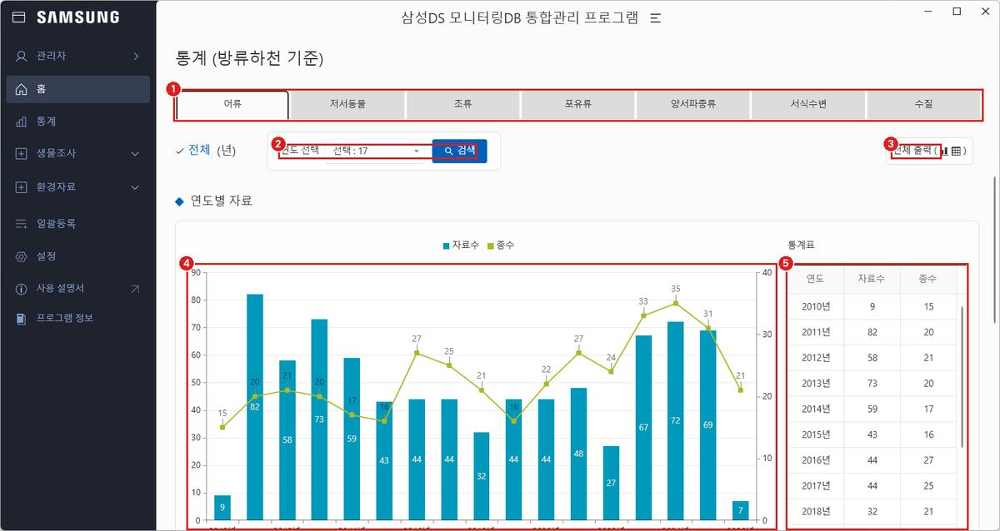

| 번호 | 설명 |
|---|---|
| ① | 분류군 |
| ② | 연도 선택 · [검색] |
| ③ | 전체 출력 |
| ④ | 연도별 자료 |
| ⑤ | 통계표 |

| 기능 | 설명 |
|---|---|
| 분류군 단추 | 분류군 바꾸기 · 누를 때마다 DB 에서 다시 읽음 |
| 「연도 선택」 | 방류하천 자료의 조사 연도 · 체크로 여러 개 · 처음엔 모두 · 두 개 이상이면 「선택 : {n}」 |
| [검색] | 고른 연도로 다시 셈 · 하나도 안 고르면 꺼짐 |
| 「전체」 「(년)」 | 지금 표에 든 연도 · 모두면 「전체」, 일부면 「{n}개」 |
| 「전체 출력」 | 그래프 그림(PNG) · 통계표(엑셀)를 한 폴더에 저장 |
| 「연도별 자료」 | 막대 = 「자료수」 · 선 = 「종수」 · 점에 마우스를 올리면 값 |
| 「통계표」 | 「연도」 · 「자료수」 · 「종수」 |

| 값 | 셈 |
|---|---|
| 「자료수」 | 그 연도 기록 수 — 목록 화면 한 줄이 기록 하나 |
| 「종수」 | 그 연도 출현종의 국명 수 — 같은 국명은 한 번 · 국명이 빈 행은 셈하지 않음 |

- 서식수변 · 수질은 「자료수」 만 있고 「종수」 는 없습니다(→ 7.2).

### 사업장 출현종

연도별 자료 아래에 사업장 · 과업 대표하천별 출현종 수가 나옵니다(어류 · 저서동물 · 조류 · 포유류 · 양서파충류 · {{그림 7-2_stats-project-species}}).

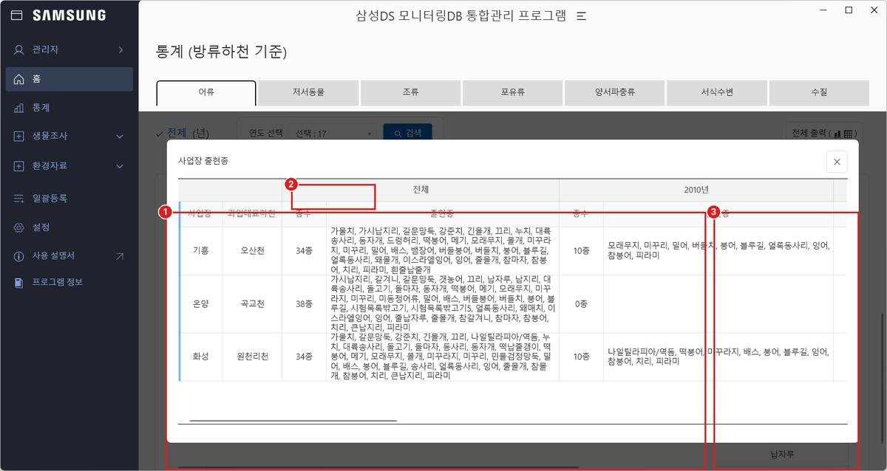

| 번호 | 설명 |
|---|---|
| ① | 사업장 · 과업 대표하천 |
| ② | [출현종 자세히 보기] |
| ③ | 출현종 |

| 기능 | 설명 |
|---|---|
| 「사업장」 · 「과업 대표하천」 건수 | 고른 연도 자료에 나오는 사업장 · 과업 대표하천 수 · 같은 이름은 한 번 |
| 표 | 줄 = 사업장 · 과업 대표하천 · 「전체」 와 「{연도}년」 묶음마다 「종수」(예 `12종`) |
| 「출현종」 | 고른 연도 전체의 국명 목록 · 이름순 · 위에 종 수 |
| [출현종 자세히 보기] | 같은 표에 묶음마다 「출현종」(국명을 쉼표로 이음)까지 펼쳐 보임 · 오른쪽 위 × 로 닫음 |

- 사업장 · 과업 대표하천 이름은 설정의 「프로젝트 사업장 지점」 값입니다(→ 6.1).

### 전체 출력

1. 「전체 출력」 을 누릅니다.
2. [폴더 선택] 창에서 저장할 폴더를 고릅니다.
3. 「저장되었습니다.」 알림이 뜨면 끝입니다.

| 파일 | 담는 것 |
|---|---|
| `{분류군}_연도별자료_{날짜시각}.png` | 연도별 자료 그래프 |
| `{분류군}_특징_{날짜시각}.png` | 특징 그래프 · 조류 · 포유류만 |
| `통계_{분류군}_{날짜시각}.xlsx` | 통계표마다 시트 하나(아래) |

| 분류군 | 엑셀 시트 |
|---|---|
| 어류 · 저서동물 · 양서파충류 | 「연도별 자료」 · 「사업장 출현종」 · 「전체 출현종」 |
| 조류 · 포유류 | 위 셋 + 「특징」 |
| 서식수변 | 「연도자료」 · 「평가등급」 |
| 수질 | 「연도별 자료」 · 「수질등급」 |

- `{날짜시각}` 은 누른 때의 `yyyyMMddHHmmss` 입니다.
- 지금 화면에 보이는 그래프 · 표를 그대로 저장합니다. 연도를 바꿨으면 먼저 [검색] 을 누릅니다.

## 7.2. 분류군별

| 분류군 | 연도별 자료 | 아래쪽 |
|---|---|---|
| 어류 · 저서동물 | 「자료수」 · 「종수」 | 사업장 출현종 |
| 조류 · 포유류 | 「자료수」 · 「종수」 | 사업장 출현종 · 「특징」 |
| 양서파충류 | 「자료수」 · 「종수」 | 사업장 출현종 · 위쪽 안내 줄 |
| 서식수변 | 「자료수」 | 「평가등급(점수)」 |
| 수질 | 「자료수」 | 「수질등급(점수)」 |

### 조류 · 포유류 — 특징

기록의 「특징」 칸 값별로 기록 수와 비율을 냅니다({{그림 7-3_stats-bird}}).

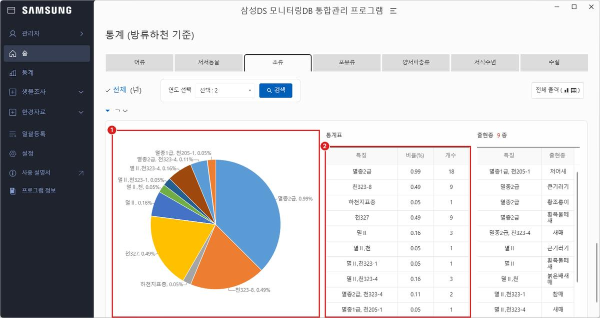

| 번호 | 설명 |
|---|---|
| ① | 특징 비율(%) |
| ② | 통계표 |

| 기능 | 설명 |
|---|---|
| 원그래프 | 「특징」 값별 조각 · 조각 이름표 = 특징, 비율% |
| 「통계표」 | 「특징」 · 「비율(%)」 · 「개수」 |
| 「출현종」 | 특징이 적힌 기록의 국명 · 「특징」 · 「출현종」 두 칸 · 위에 종 수 |

- 「개수」 = 그 특징이 적힌 기록 수입니다.
- 「비율(%)」 = 「개수」 ÷ 고른 연도의 전체 기록 수 × 100 · 소수 2자리 반올림입니다.
- 「특징」 이 빈 기록은 그래프 · 표에 나오지 않지만 나누는 수(전체 기록 수)에는 들어갑니다. 그래서 비율 합이 100 보다 작을 수 있습니다.

### 서식수변 — 평가등급(점수)

| 기능 | 설명 |
|---|---|
| 「평가등급(점수)」 「통계표」 | 줄 = 연도 · 칸 = 하천명(하천명이 빈 기록은 맨 뒤 「기타」) |
| 칸 값 | 등급(점수) — 예 `B(65.3)` · 그 연도 · 그 하천에 「평가점수」 가 있는 기록이 없으면 「-」 |

- 점수 = 그 연도 · 그 하천에서 「평가점수」 가 있는 기록의 점수 합 ÷ 그 기록 수 · 소수 1자리 반올림입니다.
- 「평가점수」 가 빈 기록(10항목 모두 빈칸 · 미평가)은 합에도 나누는 수에도 넣지 않습니다. 0점으로 세지 않습니다.
- 등급 = 80 이상 A · 60 이상 B · 40 이상 C · 20 이상 D · 그 아래 E 입니다. 목록의 「평가등급」 과 같은 구간이지만, 목록의 등급(「-」 포함)을 가져오지 않고 평균 점수로 다시 매깁니다(→ 4.1).

### 수질 — 수질등급(점수)

방류수 합류부 두 지점의 측정항목 등급을 연도별로 냅니다({{그림 7-4_stats-water}}).

| 번호 | 설명 |
|---|---|
| ① | 수질등급(점수) — 방류수 합류부 지점 |

| 기능 | 설명 |
|---|---|
| 「오산천 3 (방류수 합류부)」 | 지점명이 `오산천3` 또는 `오산천03` 인 기록 |
| 「원천리천 2 (방류수 합류부)」 | 지점명이 `원천리천2` 또는 `원천리천02` 인 기록 |
| 칸 | 「pH」 · 「BOD」 · 「COD」 · 「TOC」 · 「SS」 · 「DO」 · 「T-P」 · 「대장균군」 |
| 칸 값 | 등급(평균값) · 줄 = 연도 |

- 평균값 = 그 연도 그 지점에서 측정값이 있는 기록만의 평균 · 소수 1자리 반올림입니다. 빈 칸은 평균에 넣지 않습니다.
- 등급 기준은 수질 목록의 수질등급과 같습니다(→ 4.2).
- 측정값이 하나도 없거나 모두 0 이면 「-」 입니다.
- 두 지점 밖의 수질 기록은 「연도별 자료」 의 「자료수」 에만 들어갑니다.

### 양서파충류

화면 구성은 어류와 같고(연도별 자료 · 사업장 출현종), 위쪽에 안내 줄이 늘 보입니다({{그림 7-5_stats-amphibian}}).

| 번호 | 설명 |
|---|---|
| ① | 안내 「생태현황 자료는 통계 대상이 아닙니다.」 |

- 방류하천 양서파충류 기록이 없으면 연도 목록 · 그래프 · 표가 비어 있습니다.
- 생태현황 양서파충류 자료는 목록 화면에서 봅니다(→ 3.5).

# 8. 사용설명서 · 프로그램 정보

## 8.1. 사용설명서 창

주 메뉴 [사용 설명서](또는 [전체 메뉴] 의 「기타」 → [사용설명서])를 누르면 이 설명서가 프로그램 안의 창으로 열립니다. 이미 열려 있으면 그 창을 앞으로 가져옵니다.

| 번호 | 설명 |
|---|---|
| ① | 쪽 목록(장 · 절 제목 · 쪽 번호) |
| ② | 도구 모음 |
| ③ | [찾기] |
| ④ | 쪽 목록 접기 · 펴기 |

| 기능 | 설명 |
|---|---|
| 쪽 목록 | 쪽마다 작은 그림 · 그 쪽의 장 · 절 제목 · 쪽 번호(p1 …) — 누르면 그 쪽으로 · 표지 · 목차 쪽은 쪽 번호만 |
| 쪽 목록 접기 · 펴기 | 쪽 목록 오른쪽 위 화살표 — 접으면 본문이 넓어짐 |
| 「찾기(Ctrl+F)」 | 돋보기 · **Ctrl+F** — 글자를 넣고 앞 · 뒤로 찾음 |
| 책갈피 · 목차 | 목차의 장 · 절을 누르면 그 쪽으로 감 |

| 번호 | 설명 |
|---|---|
| ① | 저장 · 인쇄 |
| ② | 왼쪽 · 오른쪽으로 돌리기 |
| ③ | 앞쪽 · 뒤쪽 · 쪽 번호 |
| ④ | 확대 · 축소 · 배율 |
| ⑤ | 화면 이동 · 글자 고르기 |

- 저장은 이 설명서를 PDF 파일로 내려받습니다. 인쇄는 Windows 인쇄 창을 엽니다.
- 화면 이동에서는 끌어서 쪽을 옮기고, 글자 고르기에서는 글자를 끌어 골라 복사합니다.

| 번호 | 설명 |
|---|---|
| ① | 복사 · 확대 · 축소 · 화면 이동 · 텍스트 선택 · 찾기 · 인쇄 · 다른이름으로 저장 |

## 8.2. 프로그램 정보

주 메뉴 [프로그램 정보] 를 누르면 이 프로그램의 판 · 적용 지침 · 종목록 기준 · 연락처가 나옵니다.

| 번호 | 설명 |
|---|---|
| ① | 판 · 빌드 날짜 · 화면 그리기 |
| ② | [지침 원본 보기] |
| ③ | [종목록 내보내기(species.json)] |
| ④ | 개발 · 연락처 |

| 기능 | 설명 |
|---|---|
| 「판(버전)」 | 예: 1.1.2 (커밋 3ca97e0) — 문의할 때 이 줄을 알려 주세요 |
| 「빌드 날짜」 | 이 판을 만든 날 |
| 「화면 그리기」 | 「그래픽카드」 또는 「소프트웨어(software_render 파일)」(→ 9.3) |
| 「적용 지침」 | 이 판의 계산 · 종목록이 따르는 지침과 고시 번호 |
| [지침 원본 보기] | 지침 원본 PDF 를 사용설명서 창과 같은 창으로 엶({{그림 8-5_guideline}}) |
| 「종목록 기준」 | 종목록 정비 근거 · 지금 DB 의 어류 · 저서동물 종 수(지표종 수) |
| [종목록 내보내기(species.json)] | 조사자 앱용 종목록 파일(→ 6.3) |
| 「개발」 · 「연락처」 | 주식회사 에코앤지오 · www.econgeo.com · 032-888-2205 · evicdatalab@gmail.com |
| [닫기] | 창을 닫음 · **Esc** |

| 번호 | 설명 |
|---|---|
| ① | 창 제목 「지침 원본 — 국립환경과학원고시 제2026-30호」 |

- 지침 원본 창의 쪽 목록에는 쪽 제목 없이 쪽 번호만 나옵니다. 지침 별표(어류 별표 3 · 저서동물 별표 2)도 여기서 봅니다(→ 부록 C).

# 9. 설치 · 새로 설치 · 문제 해결

## 9.1. 설치 폴더

프로그램은 설치 프로그램 없이 폴더째 둡니다(.NET 설치 불필요). 설치 폴더에는 프로그램과 함께 DB · 지점 마스터 · 지도가 있습니다.

| 파일 · 폴더 | 담는 것 |
|---|---|
| `삼성DS모니터링DB통합관리프로그램.exe` | 프로그램 — 바탕 화면 바로가기는 이 파일로 |
| `SDSMDB.sqlite` | 조사 자료 DB — **원자료**. 지우거나 옮기지 않음 |
| `sites.json` | 조사지점 마스터(→ 6.2) |
| `mbtiles\` | 지도 · 주제도(약 7.3 GB) — 없으면 홈 지도가 비어 보임 |
| `Logs\` | 오류 기록 `Log_yyyyMMdd.log`(날짜마다 한 파일) |
| `읽어주세요.txt` | 흰 화면일 때 · 사용 설명서 여는 곳 · 백업 · 연락처 — 이 설명서를 열 수 없을 때 봄 |
| 그 밖의 `*.dll` 등 | 프로그램 파일 — 지우거나 따로 옮기지 않음 |

> ⚠ `SDSMDB.sqlite` 는 설치 폴더에만 있습니다. 폴더를 지우면 조사 자료도 사라집니다. 정기적으로 다른 곳에 복사해 둡니다.

## 9.2. 새 판 설치(덮어쓰기) · 새로 설치(전체 설치본)

새 판은 두 가지로 받습니다.

| 받는 것 | 들어 있는 것 | 쓰는 때 |
|---|---|---|
| 압축 `DB통합SW_yyMMdd.zip` | 프로그램 · `sites.json` · `읽어주세요.txt`(DB · 지도 없음) | 쓰던 설치 폴더에 덮어써 판만 바꿀 때 |
| 전체 설치본 `DB통합SW_yyMMdd_전체\` | 프로그램 + 정리본 `SDSMDB.sqlite` + 지도 `mbtiles\` | 처음 설치하거나 지우고 새로 설치할 때 |

### 덮어쓰기

1. 프로그램을 닫습니다.
2. 설치 폴더의 `SDSMDB.sqlite` 와 `sites.json` 을 다른 곳에 복사해 둡니다.
3. 압축을 풀면 `DB통합SW_yyMMdd\` 폴더가 하나 생깁니다. 그 **안의 파일 전부**를 설치 폴더에 복사해 덮어씁니다.
4. 프로그램을 실행하고 [프로그램 정보] 에서 판을 확인합니다(→ 8.2).

> ⚠ 압축에는 `sites.json` 이 들어 있어 설치 폴더의 것을 덮습니다. [조사지점 관리] 로 지점을 고친 적이 있으면 2.에서 복사해 둔 `sites.json` 을 꼭 보관하고, 덮어쓴 뒤 무엇이 달라졌는지 확인합니다(→ 6.2).

### 새로 설치

1. 쓰던 프로그램이 있으면 닫고, 그 폴더의 `SDSMDB.sqlite` · `sites.json` 을 복사해 둡니다.
2. 전체 설치본 폴더를 통째로 설치 위치에 둡니다.
3. 폴더 안 `삼성DS모니터링DB통합관리프로그램.exe` 를 실행합니다.

## 9.3. 문제 해결

### 화면이 하얗게만 보일 때

어떤 PC 에서는 그래픽카드로 화면을 그리지 못해 창이 하얗게만 보입니다. 이때는 소프트웨어로 그리게 합니다.

1. 프로그램을 닫습니다.
2. 설치 폴더(exe 가 있는 폴더)에 이름이 `software_render` 인 빈 파일을 만듭니다 — 폴더 빈 곳에서 마우스 오른쪽 → 새로 만들기 → 텍스트 문서 → 이름을 `software_render` 로 바꿉니다. 확장자 · 내용 · 대소문자는 상관없습니다(`software_render.txt` 도 됨).
3. 프로그램을 다시 실행합니다. [프로그램 정보] 의 「화면 그리기」 가 「소프트웨어(software_render 파일)」 이면 켜진 것입니다.

- 되돌리려면 `software_render` 파일을 지우고 다시 실행합니다.
- 이름이 다르면(예: `software_render_old.txt`) 켜지지 않습니다.
- 이 설명서를 열 수 없으면 설치 폴더의 `읽어주세요.txt` 를 메모장으로 엽니다. 같은 방법이 적혀 있습니다.

### 알림 · 오류

| 보이는 것 | 할 일 |
|---|---|
| 「파일이 실행중인지 확인하세요」 | 엑셀 · JSON 파일이 다른 프로그램(엑셀 등)에 열려 있음 — 닫고 다시 |
| 「데이터베이스 또는 테이블을 찾을수 없습니다.」 | 설치 폴더에 `SDSMDB.sqlite` 가 없거나 다른 판의 DB — 백업한 DB 를 제자리에 |
| 엑셀 가져오기가 끝나지 않음 | 함수식이 많은 엑셀 — 시트를 전체 복사해 '값만 붙여넣기' 한 뒤 다시(→ 5.1) |
| 홈 지도가 비어 보임 | 설치 폴더 `mbtiles\` 가 없거나 파일이 빠짐 — 전체 설치본의 `mbtiles\` 를 복사 |
| 그 밖의 오류 | 설치 폴더 `Logs\Log_yyyyMMdd.log` 를 문의할 때 함께 보냄 |

### 문의

주식회사 에코앤지오 · www.econgeo.com · 032-888-2205 · evicdatalab@gmail.com — [프로그램 정보] 의 「판(버전)」 줄과 오류가 난 날의 `Logs\` 기록을 함께 알려 주세요.

# 부록 A. 개발 정보

| 항목 | 내용 |
|---|---|
| 프로그램 | 삼성DS 모니터링DB 통합관리 프로그램(관리자) |
| 판 | 1.1.2 — 판 · 커밋 · 빌드 날짜는 [프로그램 정보](→ 8.2) |
| 실행 파일 | `삼성DS모니터링DB통합관리프로그램.exe` — 단독 실행형(.NET 설치 불필요) |
| 운영체제 | Windows 10 · 11(64비트) |
| 개발 언어 | C# · .NET 8 · WPF |
| 화면 부품 | Telerik UI for WPF 2026.2.520 |
| DB | SQLite — 파일 `SDSMDB.sqlite` · System.Data.SQLite 1.0.119 · Microsoft.Data.Sqlite(EF Core 9.0.7) · 둘 다 SQLite 3.46.1 |
| 지도 | MBTiles — 설치 폴더 `mbtiles\` |
| 적용 지침 | 「수생태계 현황 조사 및 건강성 평가 방법 등에 관한 지침(하천편)」 국립환경과학원고시 제2026-30호(2026. 7. 27. 개정) |
| 개발 | 주식회사 에코앤지오 |
| 연락처 | www.econgeo.com · 032-888-2205 · evicdatalab@gmail.com |
| 이 설명서 | 저장소 원고(Markdown)에서 자동으로 만든 PDF · 글꼴 Pretendard(SIL Open Font License 1.1) |

# 부록 B. 테이블 명세서

프로그램 DB(`SDSMDB.sqlite`)의 주요 표 12개입니다. 프로그램 모델과 DB 에서 자동으로 만들었습니다(`tools\manual_table_spec.py`).

| 칸 | 뜻 |
|---|---|
| 항목명 | 화면 · 엑셀 머리글에 쓰는 이름 |
| 열 이름 | DB 의 열 이름 — SQL 로 읽을 때 |
| 데이터 타입 | INTEGER(정수) · REAL(실수) · TEXT(글자 · 날짜) |
| 필수 | Y = 비울 수 없음(프로그램 또는 DB 규칙) |
| KEY | PK = 자동 번호 · FK = 다른 표의 행을 가리킴 |
| 비고 | 자동계산 · 화면 소수 n자리(화면에 보이는 자릿수) · 종목록 값 등 |

- 관리자 비밀번호 표 · 저장 이력 표 · 뷰는 싣지 않습니다. 식물상 · 식생 표도 이 판에서는 뺍니다.

<!-- manual_table_spec: 자동 생성 시작 — 직접 고치지 말 것(tools/manual_table_spec.py 로 다시 만든다) -->
<!-- manual_table_spec 근거: 모델 SDSM_Models @ 767a322 · DB SDSMDB_manual_photo.sqlite · 2026-10-28 -->

## B.1. 어류(Fish)

어류 조사 한 번(연도차수 · 지점)마다 한 줄 — 조사개황 · 채집 · 하상 · 비정상종 · 군집정보 · FAI. 출현종은 B.2.

| No. | 항목명 | 열 이름 | 데이터 타입 | 필수 | KEY | 비고 |
|---|---|---|---|---|---|---|
| 1 | ID | `FishId` | INTEGER | Y | PK | 자동 번호 |
| 2 | 연도 | `SurveyYear` | INTEGER | Y |  |  |
| 3 | 연도차수 | `YearChsu` | TEXT | Y |  |  |
| 4 | 지점명 | `Site` | TEXT |  |  | 방류하천 자료는 필수(생태현황은 비워도 됨) |
| 5 | 조사일 | `SurveyDate` | TEXT | Y |  | 2000-01-01 ~ 오늘 |
| 6 | 대권역명 | `MajorRegion` | TEXT |  |  |  |
| 7 | 중권역명 | `MiddleRegion` | TEXT |  |  |  |
| 8 | 하천명 | `River` | TEXT |  |  |  |
| 9 | 하천유형 | `RiverType` | TEXT |  |  |  |
| 10 | 위도 | `Lat` | REAL |  |  | 소수 6자리로 저장 |
| 11 | 경도 | `Lng` | REAL |  |  | 소수 6자리로 저장 |
| 12 | 날씨 | `Weather` | TEXT |  |  |  |
| 13 | 조사기관 | `SurveyAgency` | TEXT |  |  |  |
| 14 | 조사자 | `Surveyor` | TEXT |  |  |  |
| 15 | 채집 소요시간(분) | `CollectionTime` | INTEGER |  |  |  |
| 16 | 채집도구 | `CollectionTool` | TEXT |  |  |  |
| 17 | 흐름상태 | `CollectionFlowState` | TEXT |  |  |  |
| 18 | 하천차수 | `AutoRiverChasu` | INTEGER |  |  | 편집기 · 일괄등록 필수(특이사항이 조사불가 네 낱말 중 하나이거나 0종이면 빼도 됨) |
| 19 | 암반 | `Bedrock` | INTEGER |  |  |  |
| 20 | 콘크리트 | `Concrete` | INTEGER |  |  |  |
| 21 | 진흙이하(<0.063mm) | `Mud` | INTEGER |  |  |  |
| 22 | 모래(0.063-2mm) | `Sand` | INTEGER |  |  |  |
| 23 | 잔자갈(2-16mm) | `FineGravel` | INTEGER |  |  |  |
| 24 | 자갈(16-64mm) | `Gravel` | INTEGER |  |  |  |
| 25 | 작은돌(64-256mm) | `SmallStone` | INTEGER |  |  |  |
| 26 | 큰돌(>256mm) | `BigStone` | INTEGER |  |  |  |
| 27 | 하천형태 | `HabitatRiverType` | TEXT |  |  |  |
| 28 | 흐름상태 | `HabitatFlowState` | TEXT |  |  |  |
| 29 | 특이사항 | `SurveyUnavailableReason` | TEXT |  |  | 조사불가 사유 — 공백을 뺀 글이 접근불가 · 건천화 · 준설 · 공사중이면 FAI 등급 「-」 |
| 30 | 비고 | `Note` | TEXT |  |  |  |
| 31 | 기형(deformity) DE 종명(개체수) | `DECount` | INTEGER |  |  |  |
| 32 | 지느러미손상(erosion of fin) EF 종명(개체수) | `EFCount` | INTEGER |  |  |  |
| 33 | 피부손상(lesions) LE 종명(개체수) | `LECount` | INTEGER |  |  |  |
| 34 | 종양(tumors) TU 종명(개체수) | `TUCount` | INTEGER |  |  |  |
| 35 | 총 개체수 | `TotalIndividualCount` | INTEGER |  |  | 자동계산 |
| 36 | 총 종수 | `TotalSpeciesCount` | INTEGER |  |  | 자동계산 |
| 37 | 국내종 총 종수 | `M1Value` | INTEGER |  |  | 자동계산(M1) |
| 38 | 여울성 저서 종수 | `M2Value` | INTEGER |  |  | 자동계산(M2) |
| 39 | 민감 종수 | `M3Value` | INTEGER |  |  | 자동계산(M3) |
| 40 | 내성종 개체수 비율(%) | `M4Value` | REAL |  |  | 자동계산(M4) · 화면 소수 1자리 |
| 41 | 잡식종 개체수 비율(%) | `M5Value` | REAL |  |  | 자동계산(M5) · 화면 소수 1자리 |
| 42 | 충식종 개체수 비율(%) | `M6Value` | REAL |  |  | 자동계산(M6) · 화면 소수 1자리 |
| 43 | 국내종 총 개체수 | `M7Value` | INTEGER |  |  | 자동계산(M7) |
| 44 | FAI 점수 | `FAIScore` | REAL |  |  | 자동계산 · 화면 소수 1자리 |
| 45 | FAI 등급 | `FAIGrade` | TEXT |  |  | 자동계산 · A~E 또는 「-」 |
| 46 | 지점 구분 ID | `SiteDivisionId` | INTEGER |  | FK | → SiteDivision.SiteDivisionId · 저장할 때 지점명으로 맞춤 |

## B.2. 어류 출현종(FishSpecies)

어류 조사 한 번의 출현종 — 종마다 한 줄. 지표값 · 길드는 종목록(B.11) 값.

| No. | 항목명 | 열 이름 | 데이터 타입 | 필수 | KEY | 비고 |
|---|---|---|---|---|---|---|
| 1 | ID | `FishSpeciesId` | INTEGER | Y | PK | 자동 번호 |
| 2 | 어류특성확정 | `FishTrait` | TEXT |  |  | 종목록 값 |
| 3 | 내성도 길드 | `ToleranceGuild` | TEXT |  |  | 종목록 값 |
| 4 | 섭식 길드 | `FeedingGuild` | TEXT |  |  | 종목록 값 |
| 5 | 서식지 길드 | `HabitatGuild` | TEXT |  |  | 종목록 값 |
| 6 | 외래종 | `Exotic` | TEXT |  |  | 종목록 값 |
| 7 | 고유종 | `Endemic` | TEXT |  |  |  |
| 8 | 멸종위기 I급 | `Endangered1` | TEXT |  |  |  |
| 9 | 멸종위기 II급 | `Endangered2` | TEXT |  |  |  |
| 10 | 천연기념물 | `NaturalMonument` | TEXT |  |  |  |
| 11 | 계통별 순서 | `LineageOrder` | INTEGER |  |  |  |
| 12 | 강 | `ClassKo` | TEXT |  |  |  |
| 13 | 목 | `OrderKo` | TEXT |  |  |  |
| 14 | 과 | `FamilyKo` | TEXT |  |  |  |
| 15 | 국명 | `SpeciesKo` | TEXT |  |  |  |
| 16 | 학명 | `SpeciesEn` | TEXT |  |  |  |
| 17 | 개체수 | `IndividualCount` | INTEGER |  |  | 정수 |
| 18 | 어류 ID | `FishId` | INTEGER | Y | FK | → Fish.FishId |

## B.3. 저서동물(Benthos)

저서동물 조사 한 번마다 한 줄 — 조사개황 · 채집 · 서식처 · 하상 · 군집지수 · BMI. 출현종은 B.4.

| No. | 항목명 | 열 이름 | 데이터 타입 | 필수 | KEY | 비고 |
|---|---|---|---|---|---|---|
| 1 | ID | `BenthosId` | INTEGER | Y | PK | 자동 번호 |
| 2 | 연도 | `SurveyYear` | INTEGER | Y |  |  |
| 3 | 연도차수 | `YearChsu` | TEXT | Y |  |  |
| 4 | 지점명 | `Site` | TEXT |  |  | 방류하천 자료는 필수(생태현황은 비워도 됨) |
| 5 | 조사일 | `SurveyDate` | TEXT |  |  | 2000-01-01 ~ 오늘 |
| 6 | 대권역명 | `MajorRegion` | TEXT |  |  |  |
| 7 | 중권역명 | `MiddleRegion` | TEXT |  |  |  |
| 8 | 하천명 | `River` | TEXT |  |  |  |
| 9 | 하천유형 | `RiverType` | TEXT |  |  |  |
| 10 | 위도 | `Lat` | REAL |  |  | 소수 6자리로 저장 |
| 11 | 경도 | `Lng` | REAL |  |  | 소수 6자리로 저장 |
| 12 | 날씨 | `Weather` | TEXT |  |  |  |
| 13 | 조사기관 | `SurveyAgency` | TEXT |  |  |  |
| 14 | 조사자 | `Surveyor` | TEXT |  |  |  |
| 15 | Surber net(30*30) | `Surbernet30` | INTEGER |  |  |  |
| 16 | Surber net(50*50) | `Surbernet50` | INTEGER |  |  |  |
| 17 | 드렛지 | `Dredge` | INTEGER |  |  |  |
| 18 | 에크만 | `Ekman` | INTEGER |  |  |  |
| 19 | 유역이용 | `Watershed` | TEXT |  |  |  |
| 20 | 확인 가능 오염원 | `PollutionSource` | TEXT |  |  |  |
| 21 | 식생 수피도 | `CamopyCover` | TEXT |  |  |  |
| 22 | 범람원의 이용 | `Floodplain` | TEXT |  |  |  |
| 23 | 제방(좌안) | `LeveeLeft` | TEXT |  |  |  |
| 24 | 제방(우안) | `LeveeRight` | TEXT |  |  |  |
| 25 | 암반 | `Bedrock` | INTEGER |  |  | 지침 6칸 밖 · 2026-10 부터 비움(값은 특이사항으로 옮김) |
| 26 | 콘크리트 | `Concrete` | INTEGER |  |  | 지침 6칸 밖 · 2026-10 부터 비움(값은 특이사항으로 옮김) |
| 27 | 진흙 이하(<0.063mm) | `Mud` | INTEGER |  |  |  |
| 28 | 모래(0.063-2mm) | `Sand` | INTEGER |  |  |  |
| 29 | 왕모래(2~16mm) | `FineGravel` | INTEGER |  |  |  |
| 30 | 자갈(16-64mm) | `Gravel` | INTEGER |  |  |  |
| 31 | 작은돌(64-256mm) | `SmallStone` | INTEGER |  |  |  |
| 32 | 큰돌 이상(>256mm) | `BigStone` | INTEGER |  |  |  |
| 33 | 하천유형 | `HabitatRiverType` | TEXT |  |  |  |
| 34 | 하폭, 제방과 제방사이 거리(m) | `RiverWidth` | REAL |  |  | 화면 소수 1자리 |
| 35 | 수폭, 물이 흐르는 하도의 거리(m) | `WaterWidth` | REAL |  |  | 화면 소수 1자리 |
| 36 | 평균수심, 샘플링 지점 평균(cm) | `AverageDepth` | REAL |  |  | 화면 소수 1자리 |
| 37 | 평균유속, 샘플링 지점 평균(cm/s) | `AverageVelocity` | REAL |  |  | 화면 소수 1자리 |
| 38 | 기온 | `Temperature` | REAL |  |  | 화면 소수 1자리 |
| 39 | 수온 | `WaterTemperature` | REAL |  |  | 화면 소수 1자리 |
| 40 | 흐름상태 | `FlowState` | TEXT |  |  |  |
| 41 | 투명도 | `Transparency` | INTEGER |  |  |  |
| 42 | 냄새 | `Smell` | INTEGER |  |  |  |
| 43 | 특이사항 | `Note` | TEXT |  |  |  |
| 44 | 채집불가시(조사불가 사유) | `SurveyUnavailableReason` | TEXT |  |  | 공백을 뺀 글이 접근불가 · 건천화 · 준설 · 공사중이면 BMI 등급 「-」 |
| 45 | 우점도(DI) | `IndexDI` | REAL |  |  | 자동계산 · 화면 소수 2자리 |
| 46 | 다양도(H') | `IndexH` | REAL |  |  | 자동계산 · 화면 소수 2자리 |
| 47 | 종풍부도(R1) | `IndexR1` | REAL |  |  | 자동계산 · 화면 소수 2자리 |
| 48 | 균등도(J') | `IndexJ` | REAL |  |  | 자동계산 · 화면 소수 2자리 |
| 49 | BMI 점수 | `BMIScore` | REAL |  |  | 자동계산 · 화면 소수 1자리 |
| 50 | BMI 등급 | `BMIGrade` | TEXT |  |  | 자동계산 · A~E 또는 「-」 |
| 51 | 지점 구분 ID | `SiteDivisionId` | INTEGER |  | FK | → SiteDivision.SiteDivisionId · 저장할 때 지점명으로 맞춤 |

## B.4. 저서동물 출현종(BenthosSpecies)

저서동물 조사 한 번의 출현종 — 종마다 한 줄. 오탁치 · 지표가중치는 종목록(B.12) 값.

| No. | 항목명 | 열 이름 | 데이터 타입 | 필수 | KEY | 비고 |
|---|---|---|---|---|---|---|
| 1 | ID | `BenthosSpeciesId` | INTEGER | Y | PK | 자동 번호 |
| 2 | 오탁치(s) | `SaprobicValue` | REAL |  |  | 화면 소수 1자리 · 종목록 값 |
| 3 | 지표가중치(g) | `IndicatorWeight` | INTEGER |  |  | 종목록 값 |
| 4 | 멸종위기 I급 | `Endangered1` | TEXT |  |  |  |
| 5 | 멸종위기 II급 | `Endangered2` | TEXT |  |  |  |
| 6 | 한국고유종 | `Endemic` | TEXT |  |  |  |
| 7 | 문 | `PhylumKo` | TEXT |  |  |  |
| 8 | 강 | `ClassKo` | TEXT |  |  |  |
| 9 | 목 | `OrderKo` | TEXT |  |  |  |
| 10 | 과 | `FamilyKo` | TEXT |  |  |  |
| 11 | 국명 | `SpeciesKo` | TEXT |  |  |  |
| 12 | 학명 | `SpeciesEn` | TEXT |  |  |  |
| 13 | 개체수 | `IndividualCount` | REAL |  |  | 화면 소수 1자리 |
| 14 | 저서동물 ID | `BenthosId` | INTEGER | Y | FK | → Benthos.BenthosId |

## B.5. 조류(Bird)

관찰 기록마다 한 줄.

| No. | 항목명 | 열 이름 | 데이터 타입 | 필수 | KEY | 비고 |
|---|---|---|---|---|---|---|
| 1 | ID | `BirdId` | INTEGER | Y | PK | 자동 번호 |
| 2 | 연도 | `SurveyYear` | INTEGER | Y |  |  |
| 3 | 연도차수 | `YearChsu` | TEXT | Y |  |  |
| 4 | 조사일 | `SurveyDate` | TEXT |  |  |  |
| 5 | 날씨 | `Weather` | TEXT |  |  |  |
| 6 | 하천명 | `River` | TEXT |  |  |  |
| 7 | 지점명 | `Site` | TEXT |  |  | 방류하천 자료는 필수(생태현황은 비워도 됨) |
| 8 | 일반명 | `SpeciesKo` | TEXT | Y |  |  |
| 9 | 학명 | `SpeciesEn` | TEXT |  |  |  |
| 10 | 특징 | `Feature` | TEXT |  |  |  |
| 11 | 위도 | `Lat` | REAL |  |  | 소수 6자리로 저장 |
| 12 | 경도 | `Lng` | REAL |  |  | 소수 6자리로 저장 |
| 13 | 개체수 | `IndividualCount` | INTEGER |  |  |  |
| 14 | 도래유형 | `MigratoryType` | TEXT |  |  |  |
| 15 | 대항목 | `Category` | TEXT |  |  |  |
| 16 | 세부항목 | `CategoryDetail` | TEXT |  |  |  |
| 17 | 서식유형 | `HabitatType` | TEXT |  |  | 일괄등록 번호 1~6 은 이름으로 바꿔 저장 |
| 18 | 조사자 | `Surveyor` | TEXT |  |  |  |
| 19 | 특이사항 | `Note` | TEXT |  |  |  |
| 20 | 지점 구분 ID | `SiteDivisionId` | INTEGER |  | FK | → SiteDivision.SiteDivisionId · 저장할 때 지점명으로 맞춤 |

## B.6. 포유류(Mammal)

관찰 기록마다 한 줄 — 확인 · 흔적 12칸은 건수.

| No. | 항목명 | 열 이름 | 데이터 타입 | 필수 | KEY | 비고 |
|---|---|---|---|---|---|---|
| 1 | ID | `MammalId` | INTEGER | Y | PK | 자동 번호 |
| 2 | 연도 | `SurveyYear` | INTEGER | Y |  |  |
| 3 | 연도차수 | `YearChsu` | TEXT | Y |  |  |
| 4 | 조사일 | `SurveyDate` | TEXT |  |  |  |
| 5 | 날씨 | `Weather` | TEXT |  |  |  |
| 6 | 하천명 | `River` | TEXT |  |  |  |
| 7 | 지점명 | `Site` | TEXT |  |  | 방류하천 자료는 필수(생태현황은 비워도 됨) |
| 8 | 일반명 | `SpeciesKo` | TEXT | Y |  |  |
| 9 | 학명 | `SpeciesEn` | TEXT |  |  |  |
| 10 | 특징 | `Feature` | TEXT |  |  |  |
| 11 | 위도 | `Lat` | REAL |  |  |  |
| 12 | 경도 | `Lng` | REAL |  |  |  |
| 13 | 관찰지 유형 | `ObservationSite` | TEXT |  |  |  |
| 14 | 포획 | `Trace1` | INTEGER |  |  |  |
| 15 | 관찰 | `Trace2` | INTEGER |  |  |  |
| 16 | 울음 | `Trace3` | INTEGER |  |  |  |
| 17 | 사체 | `Trace4` | INTEGER |  |  |  |
| 18 | 족적 | `Trace5` | INTEGER |  |  |  |
| 19 | 털 | `Trace6` | INTEGER |  |  |  |
| 20 | 식흔 | `Trace7` | INTEGER |  |  |  |
| 21 | 굴 | `Trace8` | INTEGER |  |  |  |
| 22 | 번식지 | `Trace9` | INTEGER |  |  |  |
| 23 | 배설물 | `Trace10` | INTEGER |  |  |  |
| 24 | 카메라 | `Trace11` | INTEGER |  |  |  |
| 25 | 기타(탐문 등) | `Trace12` | INTEGER |  |  |  |
| 26 | 조사자 | `Surveyor` | TEXT |  |  |  |
| 27 | 특이사항 | `Note` | TEXT |  |  |  |
| 28 | 지점 구분 ID | `SiteDivisionId` | INTEGER |  | FK | → SiteDivision.SiteDivisionId · 저장할 때 지점명으로 맞춤 |

## B.7. 양서파충류(AmphibianReptile)

관찰 기록마다 한 줄 — 관찰 6칸은 건수.

| No. | 항목명 | 열 이름 | 데이터 타입 | 필수 | KEY | 비고 |
|---|---|---|---|---|---|---|
| 1 | ID | `AmphibianReptileId` | INTEGER | Y | PK | 자동 번호 |
| 2 | 연도 | `SurveyYear` | INTEGER | Y |  |  |
| 3 | 연도차수 | `YearChsu` | TEXT | Y |  |  |
| 4 | 조사일 | `SurveyDate` | TEXT |  |  |  |
| 5 | 날씨 | `Weather` | TEXT |  |  |  |
| 6 | 하천명 | `River` | TEXT |  |  |  |
| 7 | 지점명 | `Site` | TEXT |  |  | 방류하천 자료는 필수(생태현황은 비워도 됨) |
| 8 | 일반명 | `SpeciesKo` | TEXT | Y |  |  |
| 9 | 학명 | `SpeciesEn` | TEXT |  |  |  |
| 10 | 특징 | `Feature` | TEXT |  |  |  |
| 11 | 성체 | `Trace1` | INTEGER |  |  |  |
| 12 | 유생 | `Trace2` | INTEGER |  |  |  |
| 13 | 알 | `Trace3` | INTEGER |  |  |  |
| 14 | 울음소리 | `Trace4` | INTEGER |  |  |  |
| 15 | 로드킬 | `Trace5` | INTEGER |  |  |  |
| 16 | 기타 | `Trace6` | INTEGER |  |  |  |
| 17 | 위도 | `Lat` | REAL |  |  |  |
| 18 | 경도 | `Lng` | REAL |  |  |  |
| 19 | 대분류 | `MajorCategory` | TEXT |  |  |  |
| 20 | 중분류 | `MiddleCategory` | TEXT |  |  |  |
| 21 | 조사자 | `Surveyor` | TEXT |  |  |  |
| 22 | 특이사항 | `Note` | TEXT |  |  |  |
| 23 | 지점 구분 ID | `SiteDivisionId` | INTEGER |  | FK | → SiteDivision.SiteDivisionId · 저장할 때 지점명으로 맞춤 |

## B.8. 서식수변(HabitatWaterEdge)

조사 한 번마다 한 줄 — 평가항목 10 · 평가점수 · 평가등급.

| No. | 항목명 | 열 이름 | 데이터 타입 | 필수 | KEY | 비고 |
|---|---|---|---|---|---|---|
| 1 | ID | `HabitatWaterEdgeId` | INTEGER | Y | PK | 자동 번호 |
| 2 | 연도 | `SurveyYear` | INTEGER | Y |  |  |
| 3 | 연도차수 | `YearChsu` | TEXT | Y |  |  |
| 4 | 지점명 | `Site` | TEXT |  |  | 방류하천 자료는 필수(생태현황은 비워도 됨) |
| 5 | 조사일 | `SurveyDate` | TEXT |  |  | 2000-01-01 ~ 오늘 |
| 6 | 대권역명 | `MajorRegion` | TEXT |  |  |  |
| 7 | 중권역명 | `MiddleRegion` | TEXT |  |  |  |
| 8 | 하천명 | `River` | TEXT |  |  | 편집기 [저장] 필수(일괄등록은 빈 값도 저장) |
| 9 | 하천유형 | `RiverType` | TEXT |  |  |  |
| 10 | 위도 | `Lat` | REAL |  |  | 소수 6자리로 저장 |
| 11 | 경도 | `Lng` | REAL |  |  | 소수 6자리로 저장 |
| 12 | 날씨 | `Weather` | TEXT |  |  |  |
| 13 | 조사기관 | `SurveyAgency` | TEXT |  |  |  |
| 14 | 조사자 | `Surveyor` | TEXT |  |  |  |
| 15 | 조사불가시 | `SurveyUnavailableReason` | TEXT |  |  | 접근불가가 들어 있으면 평가등급 「-」 |
| 16 | 특이사항 | `Note` | TEXT |  |  |  |
| 17 | 자연적 종횡사주 | `EvaluationItem1` | REAL |  |  | 화면 소수 1자리 |
| 18 | 하도정비/ 하도 자연성 | `EvaluationItem2` | REAL |  |  | 화면 소수 1자리 |
| 19 | 유속 다양성 | `EvaluationItem3` | REAL |  |  | 화면 소수 1자리 |
| 20 | 하천변 폭 | `EvaluationItem4` | REAL |  |  | 화면 소수 1자리 |
| 21 | 저수로 하안공 | `EvaluationItem5` | REAL |  |  | 화면 소수 1자리 |
| 22 | 제방하안 재료 | `EvaluationItem6` | REAL |  |  | 화면 소수 1자리 |
| 23 | 저질 상태 | `EvaluationItem7` | REAL |  |  | 화면 소수 1자리 |
| 24 | 횡구조물 | `EvaluationItem8` | REAL |  |  | 화면 소수 1자리 |
| 25 | 제외지 토지 이용 | `EvaluationItem9` | REAL |  |  | 화면 소수 1자리 |
| 26 | 제내지 토지 이용 | `EvaluationItem10` | REAL |  |  | 화면 소수 1자리 |
| 27 | 평가점수 | `EvaluationScore` | REAL |  |  | 자동계산(10항목 합계 ÷ 2 · 하나도 안 골랐으면 빈칸) · 화면 소수 1자리 |
| 28 | 평가등급 | `EvaluationGrade` | TEXT |  |  | 자동계산 · A~E 또는 「-」 |
| 29 | 지점 구분 ID | `SiteDivisionId` | INTEGER |  | FK | → SiteDivision.SiteDivisionId · 저장할 때 지점명으로 맞춤 |

## B.9. 수질(WaterQuality)

조사 한 번마다 한 줄 — 측정항목 · 추가항목 · 수질등급.

| No. | 항목명 | 열 이름 | 데이터 타입 | 필수 | KEY | 비고 |
|---|---|---|---|---|---|---|
| 1 | ID | `WaterQualityId` | INTEGER | Y | PK | 자동 번호 |
| 2 | 연도 | `SurveyYear` | INTEGER | Y |  |  |
| 3 | 연도차수 | `YearChsu` | TEXT | Y |  |  |
| 4 | 지점명 | `Site` | TEXT |  |  | 방류하천 자료는 필수(생태현황은 비워도 됨) |
| 5 | 조사일 | `SurveyDate` | TEXT |  |  | 2000-01-01 ~ 오늘 |
| 6 | 대권역명 | `MajorRegion` | TEXT |  |  |  |
| 7 | 중권역명 | `MiddleRegion` | TEXT |  |  |  |
| 8 | 하천명 | `River` | TEXT |  |  |  |
| 9 | 하천유형 | `RiverType` | TEXT |  |  |  |
| 10 | 위도 | `Lat` | REAL |  |  | 소수 6자리로 저장 |
| 11 | 경도 | `Lng` | REAL |  |  | 소수 6자리로 저장 |
| 12 | 날씨 | `Weather` | TEXT |  |  |  |
| 13 | 조사기관 | `SurveyAgency` | TEXT |  |  |  |
| 14 | 조사자 | `Surveyor` | TEXT |  |  |  |
| 15 | pH | `PH` | REAL |  |  | 화면 소수 1자리 |
| 16 | BOD(mg/L) | `BOD` | REAL |  |  | 화면 소수 2자리 |
| 17 | COD(mg/L) | `COD` | REAL |  |  | 화면 소수 2자리 |
| 18 | TOC(mg/L) | `TOC` | REAL |  |  | 화면 소수 2자리 |
| 19 | SS(mg/L) | `SS` | REAL |  |  | 화면 소수 1자리 |
| 20 | DO(mg/L) | `DO` | REAL |  |  | 화면 소수 2자리 |
| 21 | T-P(mg/L) | `TP` | REAL |  |  | 화면 소수 3자리 |
| 22 | 생태독성 | `Ecotoxicity` | REAL |  |  | 화면 소수 1자리 |
| 23 | 대장균군(군수/100mL) | `EColi` | REAL |  |  | 화면 소수 1자리 |
| 24 | T-N(mg/L) | `TN` | REAL |  |  | 화면 소수 2자리 |
| 25 | 전기전도도 | `EC` | REAL |  |  | 화면 소수 1자리 |
| 26 | 염소이온(mg/L) | `Cl` | REAL |  |  | 화면 소수 1자리 |
| 27 | 황이온(mg/L) | `SO42` | REAL |  |  | 화면 소수 1자리 |
| 28 | 구리(mg/L) | `Cu` | REAL |  |  | 화면 소수 3자리 |
| 29 | 아연(mg/L) | `Zn` | REAL |  |  | 화면 소수 3자리 |
| 30 | 크롬(mg/L) | `Cr` | REAL |  |  | 화면 소수 3자리 |
| 31 | 탁도(NTU) | `Turbidity` | REAL |  |  | 화면 소수 1자리 |
| 32 | 클로로필a(mg/m3) | `Chla` | REAL |  |  | 화면 소수 1자리 |
| 33 | 수온 | `WaterTemperature` | REAL |  |  | 화면 소수 1자리 |
| 34 | 수심(cm) | `WaterDepth` | REAL |  |  | 화면 소수 1자리 |
| 35 | 유속(cm/s) | `FlowVelocity` | REAL |  |  | 화면 소수 2자리 |
| 36 | 초당유량(m3/sec) | `FlowSec` | REAL |  |  | 화면 소수 3자리 |
| 37 | 일당유량(m3/day) | `FlowDay` | REAL |  |  | 화면 소수 1자리 |
| 38 | pH 등급 | `PHGrade` | INTEGER |  |  | 자동계산 |
| 39 | BOD 등급 | `BODGrade` | TEXT |  |  | 자동계산 |
| 40 | COD 등급 | `CODGrade` | TEXT |  |  | 자동계산 |
| 41 | TOC 등급 | `TOCGrade` | TEXT |  |  | 자동계산 |
| 42 | SS 등급 | `SSGrade` | INTEGER |  |  | 자동계산 |
| 43 | DO 등급 | `DOGrade` | TEXT |  |  | 자동계산 |
| 44 | T-P 등급 | `TPGrade` | TEXT |  |  | 자동계산 |
| 45 | 대장균군 등급 | `EColiGrade` | TEXT |  |  | 자동계산 |
| 46 | 지점 구분 ID | `SiteDivisionId` | INTEGER |  | FK | → SiteDivision.SiteDivisionId · 저장할 때 지점명으로 맞춤 |

## B.10. 프로젝트 사업장 지점(SiteDivision)

설정 [프로젝트 사업장 지점]의 지점 구분 — 조사 자료가 지점 구분 ID 로 가리킨다.

| No. | 항목명 | 열 이름 | 데이터 타입 | 필수 | KEY | 비고 |
|---|---|---|---|---|---|---|
| 1 | ID | `SiteDivisionId` | INTEGER | Y | PK | 자동 번호 |
| 2 | 프로젝트명 | `Project` | TEXT | Y |  | 방류하천 · 생태현황 |
| 3 | 사업장 | `Workplace` | TEXT |  |  |  |
| 4 | 과업 대표하천 | `WorkplaceRiver` | TEXT |  |  |  |
| 5 | 지점명 | `WorkplaceSite` | TEXT |  |  |  |

## B.11. 어류 종목록(FishSpeciesList)

어류 종목록(지침 별표 3 정비) — 출현종 지표값 · 길드의 출처(부록 C).

| No. | 항목명 | 열 이름 | 데이터 타입 | 필수 | KEY | 비고 |
|---|---|---|---|---|---|---|
| 1 | ID | `FishSpeciesListId` | INTEGER | Y | PK | 자동 번호 |
| 2 | 어류특성확정 | `FishTrait` | TEXT |  |  |  |
| 3 | 내성도 길드 | `ToleranceGuild` | TEXT |  |  |  |
| 4 | 섭식 길드 | `FeedingGuild` | TEXT |  |  |  |
| 5 | 서식지 길드 | `HabitatGuild` | TEXT |  |  |  |
| 6 | 외래종 | `Exotic` | TEXT |  |  |  |
| 7 | 고유종 | `Endemic` | TEXT |  |  |  |
| 8 | 멸종위기 I급 | `Endangered1` | TEXT |  |  |  |
| 9 | 멸종위기 II급 | `Endangered2` | TEXT |  |  |  |
| 10 | 천연기념물 | `NaturalMonument` | TEXT |  |  |  |
| 11 | 계통별 순서 | `LineageOrder` | INTEGER |  |  |  |
| 12 | 강 | `ClassKo` | TEXT |  |  |  |
| 13 | 목 | `OrderKo` | TEXT |  |  |  |
| 14 | 과 | `FamilyKo` | TEXT |  |  |  |
| 15 | 국명 | `SpeciesKo` | TEXT |  |  |  |
| 16 | 학명 | `SpeciesEn` | TEXT |  |  |  |

## B.12. 저서동물 종목록(BenthosSpeciesList)

저서동물 종목록(지침 별표 2 정비) — 출현종 오탁치 · 지표가중치의 출처(부록 C).

| No. | 항목명 | 열 이름 | 데이터 타입 | 필수 | KEY | 비고 |
|---|---|---|---|---|---|---|
| 1 | ID | `BenthosSpeciesListId` | INTEGER | Y | PK | 자동 번호 |
| 2 | 오탁치(s) | `SaprobicValue` | REAL |  |  | 지표종만 값이 있음 |
| 3 | 지표가중치(g) | `IndicatorWeight` | INTEGER |  |  | 지표종만 값이 있음 |
| 4 | 멸종위기 야생생물 I급 | `Endangered1` | TEXT |  |  |  |
| 5 | 멸종위기 야생생물 II급 | `Endangered2` | TEXT |  |  |  |
| 6 | 한국고유종 | `Endemic` | TEXT |  |  |  |
| 7 | 문 | `PhylumKo` | TEXT |  |  |  |
| 8 | 강 | `ClassKo` | TEXT |  |  |  |
| 9 | 목 | `OrderKo` | TEXT |  |  |  |
| 10 | 과 | `FamilyKo` | TEXT |  |  |  |
| 11 | 국명 | `SpeciesKo` | TEXT |  |  |  |
| 12 | 학명 | `SpeciesEn` | TEXT |  |  |  |
<!-- manual_table_spec: 자동 생성 끝 -->

# 부록 C. 종목록 기준

관리자 앱의 어류 · 저서동물 종목록은 「수생태계 현황 조사 및 건강성 평가 방법 등에 관한 지침(하천편)」(국립환경과학원고시 제2026-30호) 별표 3(어류) · 별표 2(저서동물 지표종)에 맞춰 2026-10-22 에 정비했습니다. 여기에는 요약만 싣습니다. 별표 전체는 [프로그램 정보] 창의 [지침 원본 보기] 로 봅니다(→ 8.2).

| 구분 | 지침 | 앱 종목록(정비 뒤) |
|---|---|---|
| 어류 | 별표 3 · 257종 | 257종(정비 전 253종) |
| 저서동물 | 별표 2 · 지표종 447종 | 823종 — 지표값 있는 종 447 · 나머지는 지표값 없이 목록에만(정비 전 821종 · 지표값 446) |

- 지금 DB 의 종 수는 [프로그램 정보] 창 「종목록 기준」 줄 아래 「어류 {n}종 · 저서동물 {n}종(지표종 {n})」 으로 봅니다. DB 에서 그때 셉니다.
- 목록 밖 종을 목록에 더하면 어류 · 저서동물 종 수가 늘고, 지표종 수는 그대로입니다(→ C.3).
- 새로 설치한 DB(전체 설치본)는 정비가 끝난 DB 입니다. 정보 창의 어류가 253종이면 정비 전 DB 입니다.

> ⚠ 앱 화면에는 종목록을 고치는 곳이 없습니다. 앱 안에서 목록이 바뀌는 길은 일괄등록의 [목록에 추가(지표값 없음)] 하나이고, 한 번 더한 종은 앱에서 지우지 못합니다(→ 5.4).

## C.1. 어류 종목록

| 칸 | DB 열 | 설명 |
|---|---|---|
| 「어류특성확정」 | `FishTrait` | 별표 3 속성을 갖춘 종 `O` · 계산에 쓰지 않음 |
| 「내성도 길드」 | `ToleranceGuild` | 예 `SS` · `TS` · `IS` — FAI 가 `SS` 민감종 · `TS` 내성종을 셈 |
| 「섭식 길드」 | `FeedingGuild` | FAI 가 `O` 잡식종 · `I` 충식종을 셈 |
| 「서식지 길드」 | `HabitatGuild` | FAI 가 `RB` 여울성 저서종을 셈 |
| 「외래종」 | `Exotic` | 외래종 `O` · FAI 국내종 셈에서 뺌 |
| 「고유종」 · 「멸종위기 I급」 · 「멸종위기 II급」 · 「천연기념물」 | `Endemic` · `Endangered1` · `Endangered2` · `NaturalMonument` | 표시 칸 · 해당 없으면 빈칸 |
| 「계통별 순서」 | `LineageOrder` | 계통 순서 번호 · 표시용 · 2026-10 에 더한 4종은 253~256 |
| 「강」 · 「목」 · 「과」 | `ClassKo` · `OrderKo` · `FamilyKo` | 한글 이름 |
| 「국명」 · 「학명」 | `SpeciesKo` · `SpeciesEn` | 종을 맞추는 열쇠(→ C.3) |

- 2026-10-22 정비: 4종 추가(갯농어 · 브라운송어 · 납작돔 · 동갈치) · 학명 3건을 지침 표기로(가시납지리 · 흰수마자 · 무늬횟대).

## C.2. 저서동물 종목록

| 칸 | DB 열 | 설명 |
|---|---|---|
| 「오탁치(s)」 | `SaprobicValue` | BMI 에 쓰는 오탁치 · 지표종만 값 있음 |
| 「지표가중치(g)」 | `IndicatorWeight` | BMI 에 쓰는 가중치 · 지표종만 값 있음 |
| 「멸종위기 야생생물 I급」 · 「멸종위기 야생생물 II급」 · 「한국고유종」 | `Endangered1` · `Endangered2` · `Endemic` | 표시 칸 · 해당 없으면 빈칸 |
| 「문」 · 「강」 · 「목」 · 「과」 | `PhylumKo` · `ClassKo` · `OrderKo` · `FamilyKo` | 한글 이름 |
| 「국명」 · 「학명」 | `SpeciesKo` · `SpeciesEn` | 종을 맞추는 열쇠(→ C.3) |

- 오탁치 · 가중치가 빈 종은 BMI 계산에 들어가지 않습니다(가중치 0 으로 셈). DI · H′ · R1 · J′ 은 지표값과 관계없이 모든 종의 개체수로 냅니다.
- 2026-10-22 정비: *Babronia* sp. 2.8/4 · 가는점물땡땡이 2.9/3 추가 · 꼬마점물땡땡이 지표값 비움(목록에는 남음) · 학명 9종을 지침 표기로.

## C.3. 지표값 출처 · 목록 밖 종

어류 · 저서동물 일괄등록은 종 행의 지표값 · 길드를 **파일이 아니라 종목록에서** 가져옵니다(→ 5.5).

| 기능 | 설명 |
|---|---|
| 종 맞추기 | 국명 + 학명 · 띄어쓰기 · 대소문자는 가리지 않음 · 옛 학명(어류 3 · 저서 9)은 지침 표기로 바꾼 뒤 맞춤 |
| 목록 종 — 어류 | 「내성도 길드」 · 「섭식 길드」 · 「서식지 길드」 · 「외래종」 · 「어류특성확정」 을 종목록 값으로 |
| 목록 종 — 저서동물 | 「오탁치(s)」 · 「지표가중치(g)」 를 종목록 값으로 |
| 파일 값이 다를 때 | 종목록 값으로 저장 · 결과 줄 · 알림에 「{n}종 값 다름 → 종목록 값 사용」 · 풍선 글에 종별 내용 |
| 목록 밖 종 | 그 종 행의 지표값 · 길드를 비움 · 저장 때 확인 창(→ 5.4) |

- 고유종 · 멸종위기 · 계통별 순서 · 목 · 과 같은 다른 칸은 파일 값 그대로입니다.
- FAI · BMI 는 이렇게 바뀐 종 행 값으로 계산합니다.

목록 밖 종 확인 창 「종목록에 없는 종이 있습니다」 의 세 단추입니다.

| 기능 | 설명 |
|---|---|
| [목록에 추가(지표값 없음)] | 기록 저장 + 종목록에 그 종을 지표값 · 길드 없이 추가 · 강 · 목 · 과(저서는 문부터)는 파일 값 · 이미 있으면 더하지 않음 · 저장된 기록이 없으면 더하지 않음 |
| [목록에 넣지 않고 저장] | 기록만 저장 · 종목록 그대로 |
| [취소] | 저장하지 않음 |

> 「지침: 별표에 없는 종은 지수 계산에서 빠지고 출현 목록에만 오른다.」

- 어느 단추로 저장해도 목록 밖 종 행은 지표값 · 길드가 빈 채로 저장되고, 파일의 지표값은 종목록에 넣지 않습니다.
- 그래서 지표값 · 길드를 쓰는 셈(BMI · FAI 의 민감종 · 내성종 · 잡식종 · 충식종 · 여울성 저서종)에서는 빠집니다. 모든 종을 세는 값(FAI 의 국내종 수 · 개체수 · 저서 DI · H′ · R1 · J′)에는 들어갑니다.
- 목록에 더한 종은 다음 일괄등록부터 목록 종입니다. 지표값이 없으므로 파일 값이 있으면 「{n}종 값 다름 → 종목록 값 사용」 으로 비워집니다.

## C.4. 조사자 앱으로 보내기

종목록은 조사자 앱의 `species.json` 형식으로 내보냅니다(→ 6.3).

| 기능 | 설명 |
|---|---|
| [종목록 내보내기(species.json)] | [프로그램 정보] 창 「종목록 기준」 아래 |
| [종목록 내보내기 (species.json)] | 설정 「조사자 기준자료」 · 같은 동작 |
| 담는 것 | 어류 · 저서동물 두 부분만 · 칸 이름 = C.1 · C.2 의 DB 열 · 국명 순 |
| 판 | `jichim2026-30+admin-yyMMdd`(내보낸 날) · 알림 「종목록을 내보냈습니다({판}).」 |

- 조사자 앱 v0.5.0 이상은 이 파일을 `%AppData%\SDSM_Surveyor\species.json` 에 두면 「어류 · 저서만 이 파일로 바뀌고」, 조류 · 포유류 · 양서파충류는 조사자 앱에 든 목록을 씁니다.
- 목록 밖 종을 더했거나 DB 를 바꿨으면 다시 내보내 조사자에게 보냅니다. 조사자 화면의 FAI · BMI 가 관리자 계산과 같으려면 두 앱의 종목록이 같아야 합니다.
